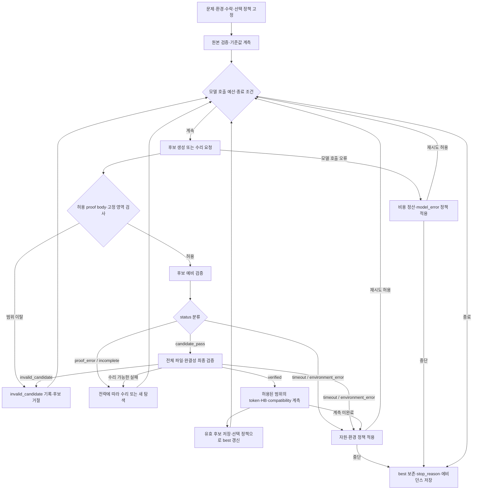

# DESIGN — Lean Refactor Arena 검증·수리 통합 실험

> **문서 상태:** 실행 전 실험 설계안. 실측 결과나 구현 완료 보고서가 아니다.
>
> **핵심 목표:** 제한된 모델 호출 예산 안에서 **proof token 감소율, heartbeat 감소율, zero-shot compatibility**가 높은 유효 후보를 찾는다. 검증·수리의 정확성과 재현성 실험은 이 성능 비교를 신뢰할 수 있게 하는 보조 실험으로 둔다.
>
> **작성 근거:** 첨부 `DESIGN.md`의 대회 지표 중심 설계[S1]와 `DESIGN(1).md`의 검증·수리 설계[S2]. 외부 규칙 재조회, benchmark 파일 검사, 모델 호출, Lean 실행은 이 문서를 작성하면서 수행하지 않았다. 원문의 공식 규칙·기준값 서술은 제공된 설계의 전제로 보존하며, 실행 전에 사용할 공식 snapshot과 대조한다.

---

## 1. 목적과 통합 원칙

검증·수리 시스템은 단순히 증명을 완성하는 도구가 아니라, **문제별 모델 API 예산 USD 3 이하라는 제약 아래 높은 평가 점수의 증명을 탐색하고 보존하는 구성 요소**다.[S1]

상태별 분류는 실패 후보를 수리할지, 폐기하고 새 후보를 생성할지, 환경·자원 문제로 중단할지 결정하는 데 사용한다. 유효한 후보를 얻은 뒤에도 예산과 정책이 허용하면 탐색을 계속한다. 최종 결과는 마지막으로 생성한 후보가 아니라 **수락 조건을 만족하는 후보 중 선택 정책으로 정한 best-so-far**다.

두 원문의 실험은 삭제하거나 서로 대체하지 않고 다음 두 실험군으로 구분한다.

| 실험군 | 역할 | 핵심 판단 |
| --- | --- | --- |
| **P / Performance** | 대회 지표 중심의 주 실험 | 같은 예산에서 어느 전략이 token·HB·compatibility 및 종합 점수를 개선하는가? |
| **V / Verification & Repair** | 판정 신뢰성·수리 메커니즘·재현성 보조 실험 | 점수의 근거가 되는 후보, 판정, 상태 전이와 비용 기록을 신뢰할 수 있는가? |

`verified` 비율, 수리 횟수, 오수락 수, 기록 재생 일치율을 대회 점수 대신 사용하지 않는다. 반대로 높은 점수만으로 검증기나 비용 통제의 정확성을 입증했다고 판단하지 않는다.

### 1.1 원문 간 차이와 통합 방식

아래 내용은 원문의 조건을 숨기지 않고 함께 사용하기 위한 **통합 편집 결정**이다. 원문에 없던 실행값·정책은 각 절에서 ‘추가 제안’ 또는 ‘확정 필요’로 표시한다.

| 항목 | 원문에서의 차이 또는 미정 사항 | 통합 방식 |
| --- | --- | --- |
| A·B·C 명칭 | 두 문서가 같은 문자를 다른 실험에 사용 | 대회 지표 실험은 `P-A/B/C`, 신뢰성 실험은 `V-A/B/C`로 구분 |
| 전체 대상 | [S1]은 15문제·3회 반복을 제안하고, [S2]는 JSONL의 문제 전체를 지정 | 입력 JSONL 전체가 대상. 실제 문제 수 `N`을 읽어 기록하고, 15문제 기준 계산은 계획값으로 표시 |
| 원본 proof 제공 | 리팩터링에는 원본이 입력이지만, [S2]의 수리 실험은 정상 원본을 숨김 | P 실험에는 원본을 제공하고, V-B에는 손상 proof만 제공. 서로 다른 과제로 집계 |
| `verified` 이후 | 수리 성공과 탐색 종료가 혼동될 수 있음 | 후보 검증 완료와 runner 종료를 분리. P 실험은 탐색 지속, V-B는 첫 검증 성공까지의 복구를 측정 |
| 다중 버전 평가 | 종합 점수 기반 선택과 ‘후보 확정 후 타 버전 평가’가 함께 제안됨 | 다중 버전 활용 모드와 holdout 전이 모드를 별도 프로토콜로 유지 |
| 반복과 USD 3 | 문제당 예산과 연구용 여러 반복의 합계가 다름 | 독립 실행별 상한과 전체 연구 비용을 모두 기록. 여러 실행 중 최고 결과를 고른 비용을 숨기지 않음 |
| 공식 점수 | 규칙 서술은 있으나 고정 revision·worker 식별자는 없음 | `score_local`과 실제 `score_official`을 구분. 공식 일치 확인 전에는 ‘대회식 로컬 점수’로 표시 |

## 2. 실험 전체 구성

| ID | 실험 | 연구 질문 | 모델 호출 | 원문 대응 |
| --- | --- | --- | --- | --- |
| **P-A** | 동일 예산의 검증·수리 전략 비교 | 실패 폐기, 오류 수리, 점수 피드백이 최종 대회 지표를 어떻게 바꾸는가? | 필요 | [S1] A |
| **P-B** | Token·HB·compatibility 상충관계와 선택 정책 | 같은 후보 집합에서 무엇을 최소화·최대화하느냐에 따라 최종 선택이 어떻게 달라지는가? | 추가 호출 없음 | [S1] B |
| **P-C** | 비용에 따른 점수 개선 | 누적 비용에 따라 best-so-far가 어떻게 개선되는가? | P-A 기록 재사용 | [S1] C |
| **V-A** | 검증 판정 방식 비교 | 단순 판정이 놓치는 미완성·무효 후보를 제안 방식이 구분하는가? | 없음 | [S2] A |
| **V-B** | 원시 진단 대 구조화 피드백 | 동일한 오류에서 피드백 표현과 수리 정책이 복구 결과를 바꾸는가? | 필요 | [S2] B |
| **V-C** | 부모 하네스 제어와 재현성 | 새 생성, 기록 재생, Lean 재검증을 구분해 상태·선택·종료를 확인할 수 있는가? | 기존 기록 재사용 우선 | [S2] C 및 [S1] C |

모든 실험은 **조건 → 독립 실행 수 → 측정 지표 → 실제 로그 → 결과 해석 → 확인하지 못한 범위 → 재실행 방법** 순서로 보고한다. 새 모델 생성 횟수, 후보 제출 횟수, Lean 검증 횟수, 저장 기록 재생 횟수는 별도로 센다.[S2]

---

## 3. 공통 실험 조건

### 3.1 데이터와 환경

| 항목 | 설계 |
| --- | --- |
| 입력 | 원문 경로 `../benchmark_data_warmup.jsonl`. 실제 실행에서는 기준 디렉터리와 resolved path를 기록 |
| 문제 범위 | JSONL에 포함된 문제 전체. P7·P12는 준비 상태를 확인할 파일럿 후보이며 전체 평가 대상을 대체하지 않음 |
| 문제 식별 | 공식 식별자 또는 정리의 완전한 이름을 기본 키로 사용. P01 등은 표시용 ID로 분리 **[추가 제안]** |
| 고정 대상 | 명제·가정·주변 문맥·원본 소스·Lean toolchain·의존성 revision·검증 설정 |
| 수정 허용 | 대상 정리의 proof body만 교체 |
| 기준 증명 | 지정 환경에서 정상 여부를 확인한 원본 proof와 그 계측값 |
| 모델 조건 | 동일 비교 안에서는 모델 ID, effort, sampling 설정, 접근 자료, 도구 권한, 출력 한도를 고정 |
| 독립 실행 | 새 모델 이력과 분리된 실행 상태에서 시작. 다른 실행의 후보·정답·로그를 입력으로 재사용하지 않음 |
| 기록 | 후보·부모 후보·진단·phase·status·stop_reason·해시·모델 호출·비용·검증·계측 결과 |

원본의 정상 여부가 확인되지 않은 문제를 정상 기준으로 사용하지 않는다. 환경 실패나 계측 누락을 후보의 증명 실패 또는 점수 0으로 임의 대체하지 않고 원인과 처리 정책을 기록한다.

### 3.2 원본 proof의 공개 범위

**P 실험:** 원래 문제와 정상 proof를 입력으로 주고 리팩터링을 요청한다. 원본의 유지·복사가 일어났는지 함께 기록한다.

**V-B:** 정상 원본은 평가자가 보관하고, 모델에는 같은 오류가 삽입된 현재 proof와 필요한 문제 문맥만 제공한다.[S2] 정상 proof를 파일 도구나 다른 실행 기록을 통해 읽을 수 있는지도 통제·기록한다. 프롬프트에서만 조회를 금지한 경우 완전한 접근 차단을 달성했다고 쓰지 않는다.

### 3.3 원문에 기록된 P7·P12 기준값

아래는 **[S1]의 기록을 보존한 값**이며, 이 통합 작업에서 공식 데이터나 로컬 실행으로 확인한 값이 아니다. 실행 입력으로 사용하기 전에 benchmark snapshot, 문제 식별자, 단위 및 해당 버전을 확인한다.

| 항목 | P7 · CSLib | P12 · ArkLib |
| --- | ---: | ---: |
| 원본 proof token | 408 | 1,353 |
| 원문이 ‘공식 기준 heartbeat’로 제시한 값 | 59,830 | 9,198 |
| 지정 Lean 버전 수 | 3 | 3 |
| compatibility 표시 범위 | 0/3–3/3 | 0/3–3/3 |
| 독립 성능 실행의 모델 예산 상한 | USD 3 | USD 3 |

이 값으로 나머지 문제의 기준값을 추정하지 않는다. 모든 문제의 지정 버전 수가 3개라고 가정하지도 않는다.

## 4. 평가 지표와 비용 계약

### 4.1 주요 지표

원문의 감소율 정의를 퍼센트 단위로 명시하면 다음과 같다. 원본·후보의 token 계수 방식과 HB 측정 환경·단위는 같아야 한다.

\[
R_{\mathrm{token}}(c)=100\left(1-\frac{T(c)}{T_0}\right)
\]

\[
R_{\mathrm{HB}}(c;e)=100\left(1-\frac{H(c;e)}{H_0(e)}\right)
\]

\[
C_{\mathrm{zero\text{-}shot}}(c)=100\frac{k(c)}{m}
\]

\[
S(c)=\frac{R_{\mathrm{token}}(c)+R_{\mathrm{HB}}(c)+C_{\mathrm{zero\text{-}shot}}(c)}{3}
\]

`T`는 proof body token 수이며 모델 API의 입력·출력 token 수가 아니다. `H`는 검증 작업량으로 기록하는 heartbeat이며 경과 시간과 구분한다. `m`은 해당 문제에 지정된 환경 수, `k`는 **동일한 proof bytes**가 수정 없이 통과한 환경 수다.[S1]

**측정 경계:** [S1]은 위 평균을 공식 점수로 서술하지만, 현재 첨부 자료에는 clipping, 실패 시 0점 처리의 상세 조건, HB 평가 버전 및 집계 방식, worker 식별자가 없다. 이 항목들을 고정하기 전에는 로컬 계산을 공식 결과라고 표시하지 않는다.

| 기록 필드 | 의미 |
| --- | --- |
| `score_local` | 문서의 정의 및 고정한 로컬 수락·계측 정책으로 계산한 점수 |
| `score_official` | 실제 공식 평가로 확인된 결과. 확인 전에는 `null` |
| `score_policy_id` | 실패·음수 감소율·원본 fallback·다중 버전 결과를 처리하는 정책의 식별자 |
| `metric_environment_id` | token/HB 비교의 기준 환경 및 worker 식별자 |
| `measurement_unit` | HB raw/scaled 구분과 변환 규칙 |

음수 감소율을 임의로 0으로 자르지 않는다. 분모가 0이거나 계측이 없으면 정의되지 않은 값을 0점으로 대체하지 않는다. 공식 처리 규칙이 확인되면 그 규칙을 명시적으로 적용한다. 여러 환경의 HB를 평균할지는 원문에서 확정하지 않았으므로, 임의로 평균하지 않는다.

### 4.2 유효성·compatibility·점수의 분리

`verified`는 **기록된 검증 범위의 수락 기준을 충족했다**는 뜻이다. 한 환경의 `verified`를 지정 환경 전체의 통과로 확장하지 않는다. `verification_scope`, 환경별 결과, 검사가 끝난 환경 수를 함께 저장한다.

[S1]은 부분 compatibility 후보도 다른 지표와 함께 비교하도록 제안한다. 따라서 기본 환경에서 검증된 후보가 다른 버전에서 실패했다는 이유만으로 일괄 폐기하는 정책을 자동 채택하지 않는다. 다만 어떤 환경 실패가 전체 무효를 만드는지는 실행 전에 고정한 수락·공식 평가 정책을 따른다.

미검증·환경 오류로 미완료인 항목을 통과로 세지 않는다. 전 환경 결과가 완료되지 않은 상태는 `compatibility_complete=false`로 기록하며, 공식 정책 확인 없이 미완료를 논리적 실패로 바꾸지 않는다. 명제 변경·허용 범위 이탈·미완성 증명은 높은 길이 감소율로 보상하지 않는다.

### 4.3 두 가지 다중 버전 프로토콜

원문에 함께 제안된 두 방식을 분리한다. **어느 모드를 사용했는지 지정하지 않은 결과는 서로 합산하지 않는다.**

| 모드 | 탐색·선택 중 사용 가능한 정보 | 최종 평가와 해석 |
| --- | --- | --- |
| **M · 다중 버전 지표 활용** | 지정 버전 검사 결과를 runner가 선택에 사용. P-A3의 종합 점수 피드백에 포함할 수도 있음 | 같은 proof의 버전별 통과율을 평가. 타 버전 결과를 활용했다면 이를 공개하고 ‘보지 않은 버전으로의 전이’라고 부르지 않음 |
| **H · 단일 버전 탐색 후 holdout 평가** | 탐색·수리·주 선택에는 기준 버전 정보만 사용 | 선택 후보 해시를 확정한 뒤 다른 버전 검사. 그 결과를 모델 수리나 주 후보 재선택에 사용하지 않음 |

모드 M에서 타 버전 피드백·후보 선택이 대회 규칙상 허용되는지는 **확정 필요**다. 원문의 ‘동일 proof 무수정 검사’ 정의만으로 모든 정보 활용 방식이 허용된다고 단정하지 않는다.

모드 H에서는 탐색용 선택 점수를 token·기준 버전 HB의 조합으로 별도 고정해야 한다. **추가 제안:** `search_score=(R_token + R_HB)/2`. 이는 공식 종합 점수가 아니며, 미확인 compatibility를 0 또는 100으로 채우는 방식도 아니다.

P-B에서 모든 후보의 holdout 결과를 뒤늦게 측정해 B3/B4를 적용할 수는 있다. 이 결과는 **사후 선택 분석**으로 표시하고, holdout을 보지 않고 선택한 실제 결과와 구분한다.

### 4.4 모델 비용과 USD 3 상한

[S1]의 예산 전제는 문제당 모델 API 호출 USD 3 이하이며, 실패 시도·폐기 후보를 포함한다. 생성·수리·계획·평가를 위한 모델 호출, 하위 에이전트 호출 및 과금된 재시도 비용을 모두 해당 실행에 귀속한다. Lean 실행 시간은 모델 API 비용과 구분해 기록한다.

**추가 제안: 호출 전 비용 예약.** 병렬 호출이 있다면 이미 예약한 금액까지 포함해 다음 조건을 검사한다.

\[
\mathrm{spent}+\mathrm{reserved}+\mathrm{next\_call\_upper\_bound}\leq 3.00
\]

상한은 실제 모델·요금 snapshot·입력 길이·출력 및 과금 가능한 추론 token 한도로 계산한다. 보수적인 호출 비용 상한을 계산할 수 없다면 USD 3의 엄격한 사전 보장을 달성했다고 표시하지 않는다. 호출 후에는 실제 사용량 및 과금 정보를 정산하고 추정값과 구분한다.

[S1]은 Closed-source 트랙의 OpenRouter 경유 및 공개 정가 기준 보고를 요구사항으로 서술한다. 이 통합안에서 별도 검증한 사항은 아니므로 실행 전 공식 경로·계산 기준을 확인하고 `pricing_snapshot`, `billing_basis`에 보존한다. 계정 청구액과 대회 기준 비용이 다르면 둘 다 기록한다.

**연구 전체 비용은 USD 3이 아니다.** 독립 반복마다 USD 3 상한을 적용해도 같은 문제에 세 번 실행하면 연구 비용은 최대 USD 9다. 여러 전략·반복 중 최고 후보를 선택해 제출하면서 그 전체 생성 비용을 숨기고 ‘USD 3 실행’이라고 보고하지 않는다. 연구용 반복 비교와 대회 제출용 실행을 별도 식별한다.

---

## 5. 공통 runner와 상태 모델

### 5.1 제어 흐름

모델은 후보만 제안한다. 문제·환경, 허용 수정 범위, 검증·선택, 비용 및 종료 정책은 부모 runner가 소유한다.[S1][S2]

아래 Mermaid는 [S1]의 렌더링 잔여물로 손상된 흐름도를 텍스트 원문에 맞춰 재구성한 통합안이다. 예산 사전 검사와 실패 경로를 명시적으로 추가했다.



모드 H의 다른 버전 검사는 주 후보를 확정한 뒤 수행한다. V-B에서는 첫 `verified`를 얻으면 복구 실험을 종료한다. P-A에서는 `verified`만으로 종료하지 않고 best를 보존한 채 정한 예산·정책까지 탐색한다.

### 5.2 후보 `status`

기존 검증·수리 상태 구분을 공통 계약으로 명시한다. 상태는 실제 진단 원문을 대체하지 않으며 `phase=candidate|final` 및 환경 식별자와 함께 기록한다.

| status | 의미 | 후속 조치 |
| --- | --- | --- |
| `candidate_pass` | 해당 범위의 예비 검사 통과 | 전체 파일 및 최종 수락 조건 검사 |
| `proof_error` | 타입·구문·tactic 오류 등 후보 증명의 구체적 오류 | 전략에 따라 진단을 전달해 수리하거나 후보 폐기 |
| `incomplete` | 남은 목표 또는 금지된 미완성 의존성 | 수리 또는 후보 폐기. 성공으로 집계하지 않음 |
| `invalid_candidate` | 허용 범위 이탈 또는 고정 문제 변경 | 적용·수락하지 않고 거절 |
| `timeout` | 제한 시간·계산량 안에서 검증 판정을 완료하지 못함 | 자원 실패 기록 및 사전 고정 정책 적용 |
| `environment_error` | toolchain·설치·고정 의존성 등 환경 문제 | 증명 수정과 구분해 환경 점검 또는 중단 |
| `verified` | 명시된 범위의 최종 수락 조건 충족 | 유효 후보 저장. P 실험에서는 계측·선택 후 탐색 지속 가능 |

오류와 미완성 징후가 함께 나타날 때의 대표 상태 우선순위, goals를 얻지 못했을 때의 처리, 간접 미완성 의존성 검사 방법은 V-A 전에 고정한다. **goal 정보가 없다는 사실을 `goals=[]`로 치환하지 않는다.**

### 5.3 runner `stop_reason`

`status`는 후보에 대한 판정이고, `stop_reason`은 실행을 끝낸 이유다. 예산 종료 시에도 이미 검증된 best가 있을 수 있으므로 둘을 한 필드에 합치지 않는다.

| stop_reason | 사용 범위 |
| --- | --- |
| `verified` | V-B 등 첫 검증 성공을 종료 조건으로 삼는 실험 |
| `repair_limit` | 실행에 지정한 수리 횟수 상한 도달 |
| `wall_time_limit` | 전체 실행 시간 상한 도달 |
| `repeated_candidate` | 사전 정의한 반복 후보 종료 조건 충족 |
| `environment_error` | 환경 문제로 실행 중단 |
| `model_error` | 모델 호출·응답 문제로 실행 중단 |
| `budget_limit` | 다음 호출의 비용을 포함하면 상한을 지킬 수 없음 **[추가 제안]** |
| `policy_complete` | One-shot 완료 등 전략이 지정한 작업 완료 **[추가 제안]** |

후보별 수리 상한 때문에 새 탐색으로 전환하는 경우에는 전체 runner가 종료된 것이 아니다. **추가 제안:** `repair_chain_stop_reason`을 별도 기록하고 `stop_reason`은 실행 종료 시 한 번 확정한다. 상한·반복 기준·재시도 횟수는 실험 조건에 포함한다.

### 5.4 수락과 best 보존

최종 수락 시에는 고정 영역 보존, 대상 정리 대응, 전체 파일 검사, 미완성·금지 의존성, 지정된 공리 정책을 확인한다. 세부 허용 공리·금지 구문 목록은 원문에 없으므로 실행 전 확정한다.

검증에 사용한 후보와 저장한 후보의 해시를 연결하고, 새 후보가 실패해도 기존 best를 덮어쓰지 않는다. **추가 제안:** 원본 fallback을 허용할지 모든 전략에서 동일하게 고정한다. 원본을 유지했다면 `selected_origin=baseline`으로 표시하고, 생성 후보 성공 또는 개선 성공으로 세지 않는다.

---

## 6. P-A — 동일 예산의 검증·수리 전략 비교

**REPAIR STRATEGY COMPARISON · 주 실험 · [S1] A**

### 6.1 연구 질문과 조건

동일한 모델 API 예산에서 실패한 후보를 수리하는 것이 새 후보를 생성하는 것보다 높은 대회식 점수를 얻는가? 유효 후보의 점수 피드백을 추가하면 어떤 지표가 달라지는가?

| 조건 | 동작 | 모델에 전달하는 피드백 |
| --- | --- | --- |
| **A0 · One-shot** | 리팩터링 후보 한 번 생성 후 검증·결과 확정 | 추가 수리·최적화 피드백 없음 |
| **A1 · No repair** | 실패 후보는 폐기하고 원본 기반의 새로운 후보 탐색 반복 | 실패 여부는 알 수 있으나 실패 proof와 구체 진단을 이용한 수리는 하지 않음 |
| **A2 · Repair** | 실패 후보에 Lean 오류 피드백을 주어 수정·재검증. 유효 후보 확보 후 탐색 지속 | 현재 proof와 실제 Lean 진단. 수치 점수 피드백은 추가하지 않음 |
| **A3 · Score-aware repair** | A2에 유효 후보의 token·HB·점수 피드백을 추가 | A2의 정보 + 프로토콜상 공개 가능한 계측값·점수 |

A1–A3의 문제 입력, 모델 설정, 수정 허용 범위, API 비용 상한, 검증기, 최종 선택 정책은 같다. **진단·점수의 제공 방식과 이에 따른 다음 행동만 전략의 차이로 둔다.** 모델이 사용할 수 있는 도구를 통해 추가 계측값을 직접 얻는 경우도 정보 노출로 기록한다.

A0는 호출 한 번의 저비용 기준선이다. A1–A3와 같은 비용을 모두 소비한 조건으로 취급하지 않는다. 동일 USD 3 상한도 동일 호출 수·동일 token 수·동일 경과 시간을 의미하지 않으므로 실측 사용량을 함께 제시한다.

### 6.2 실행 규모와 비용

[S1]의 기본 계획은 **15문제 각각 독립 실행 3회**다. 실제 입력 문제 수를 `N`, 반복 수를 `R=3`으로 기록한다. A0를 몇 번 실행할지는 원문에 별도로 확정되어 있지 않으므로, 아래 전체 계산은 **A0도 3회 반복하는 추가 제안**을 적용한 값이다.

| 범위 | 계획 실행 수 | 모델 API 비용의 보수적 합계 상한 |
| --- | ---: | ---: |
| A1–A3, 15문제, 각 3회 | 135 | USD 405 |
| A0, 15문제, 각 3회 **[추가 제안]** | 45 | USD 135 이하. 단일 호출이므로 실제 비용은 별도 측정 |
| 전체 A0–A3 | 180 | USD 540 이하 |
| P7·P12 파일럿, A0–A3, 각 3회 **[추가 제안]** | 24 | USD 72 이하 |

이는 실행 승인이나 실제 소비액이 아니라 **실험 조건에서 계산한 최대 연구 예산**이다. P-B·P-C는 이 실행들의 기록을 재사용한다. V-B의 별도 호출 비용은 포함하지 않는다.

### 6.3 실행 절차

1. 문제·환경·정상 원본·기준 계측을 고정하고 동일한 초기 입력 묶음을 준비한다.
2. 전략별로 새 이력에서 시작해 생성 → 검증 → 수리/재탐색 → 계측을 수행한다.
3. 각 모델 호출 전에 비용을 검사하고, 모든 후보·실패·호출 비용·상태 전이를 저장한다.
4. 후보마다 같은 검증기와 선택 정책을 적용한다. 전략이 달라도 runner의 수락 기준은 바뀌지 않는다.
5. 종료 시 선택 후보와 실제 파일 bytes를 고정하고 최종 재검증한다. 실패 시 후순위 후보·원본으로 되돌아갈지 등의 처리도 사전에 고정한다.
6. 모드 H라면 선택 확정 후에만 타 버전 검사를 수행한다. 최종 재검증을 추가 모델 수정 피드백으로 사용할 경우에는 탐색 단계와 비용에 포함한다.

### 6.4 결과 표와 해석

**아래는 기록 형식이며 실측 결과가 아니다.** 문제·조건·반복별 원시 표를 먼저 만들고 요약한다.

| 지표 | A0 | A1 | A2 | A3 |
| --- | --- | --- | --- | --- |
| Token 감소율 (%) | 미측정 | 미측정 | 미측정 | 미측정 |
| HB 감소율 (%) | 미측정 | 미측정 | 미측정 | 미측정 |
| Compatibility (k/m, %) | 미측정 | 미측정 | 미측정 | 미측정 |
| 대회식 종합 점수 | 미측정 | 미측정 | 미측정 | 미측정 |
| 모델 API 비용 (USD) | 미측정 | 미측정 | 미측정 | 미측정 |
| 생성 / 수리 / 검증 횟수 | 미측정 | 미측정 | 미측정 | 미측정 |
| 원본 유지 / 생성 후보 선택 | 미측정 | 미측정 | 미측정 | 미측정 |
| 최종 stop_reason | 미측정 | 미측정 | 미측정 | 미측정 |

**A1 대 A2**는 같은 예산을 새 탐색과 수리에 배분하는 전략 차이를, **A2 대 A3**는 계측·점수 피드백을 추가한 차이를 관찰한다. 수리 때문에 줄어든 새 탐색 기회와 증가한 프롬프트 비용까지 포함한 결과이지, 동일 호출 수에서의 순수한 오류 수정 능력만 비교한 결과가 아니다.

최종 점수와 함께 개별 지표를 보고한다. 수리 성공률이 높아져도 token·HB·compatibility가 개선되지 않을 수 있으며, 그 경우를 실패한 실험으로 숨기지 않는다.

## 7. P-B — 다목적 상충관계와 후보 선택 정책

**MULTI-OBJECTIVE TRADE-OFF · 후속 분석 · [S1] B**

### 7.1 연구 질문과 후보 집합

가장 짧은 증명, HB가 가장 작은 증명, 호환성이 가장 높은 증명, 종합 점수가 가장 높은 증명은 같은가?

P-A에서 생성한 유효 후보를 재사용한다. 기본 분석 단위는 **한 문제·한 전략·한 독립 실행에서 얻은 후보 집합**이다. 서로 다른 독립 실행의 후보를 합쳐 하나의 USD 3 실행이 얻은 후보군처럼 표시하지 않는다.

새 모델 호출은 하지 않는다. 저장 후보의 계측·다중 버전 검사가 추가로 필요할 수 있으며, 그 Lean 실행 횟수와 비용은 별도로 기록한다.

### 7.2 선택 정책

| 정책 | 선택 기준 |
| --- | --- |
| **B1** | Proof token 수 최소 |
| **B2** | 기준 측정 환경의 heartbeat 최소 |
| **B3** | Zero-shot compatibility 최대 |
| **B4** | 대회식 종합 점수 최대 |

모든 정책에 동일한 유효 후보 집합과 원본 fallback 정책을 적용한다. 정책별 동점 규칙은 사전 고정한다. **추가 제안:** 주 지표가 같으면 token, HB, proof SHA-256 순으로 비교하고, 이미 주 지표인 항목은 건너뛴다.

후보별로 token·HB 및 지정 버전의 통과/실패/미완료를 저장한다. 모드 H에서 B3/B4를 타 버전 결과를 본 뒤 적용한 결과는 사후 비교이며, 원래 확정했던 주 후보의 결과를 교체하지 않는다.

### 7.3 관측과 결과 형식

| 문제 / run | 정책 | 선택 후보 | Token 감소율 | HB 감소율 | Compatibility | 종합 점수 | 실제 선택 / 사후 분석 |
| --- | --- | --- | --- | --- | --- | --- | --- |
| 실행 후 기입 | B1 | 미측정 | 미측정 | 미측정 | 미측정 | 미측정 | 미기입 |
| 실행 후 기입 | B2 | 미측정 | 미측정 | 미측정 | 미측정 | 미측정 | 미기입 |
| 실행 후 기입 | B3 | 미측정 | 미측정 | 미측정 | 미측정 | 미측정 | 미기입 |
| 실행 후 기입 | B4 | 미측정 | 미측정 | 미측정 | 미측정 | 미측정 | 미기입 |

보고서에는 token 감소율–HB 감소율 산점도에 compatibility를 함께 표시하고, 정책별 선택 후보를 구분한다. 원문의 P7·P12처럼 지정 환경이 3개인 경우 `3/3`, `2/3`을 표시하되, 다른 문제에는 실제 분모를 사용한다.

**해석의 경계:** 같은 측정값으로 종합 점수를 최대화하는 B4가 그 점수에서 가장 좋은 것은 선택 기준의 정의에 따른다. 이 분석의 목적은 B4의 생성 능력을 입증하는 것이 아니라 **단일 지표 선택의 손실, 지표 간 순위 충돌, 동일 후보군에서 선택 정책이 만드는 차이**를 밝히는 것이다. 후보 생성의 기여와 최종 선택의 기여를 구분한다.

## 8. P-C — 모델 비용에 따른 점수 개선

**BUDGET–PERFORMANCE & REPRODUCIBILITY · 후속 분석 · [S1] C**

### 8.1 연구 질문과 예산 체크포인트

누적 모델 호출 비용이 늘면서 best-so-far는 언제, 어떤 수리·탐색 단계에서 개선되는가? 제한된 예산에서 개선이 정체되는 구간은 어디인가?

P-A의 비용·후보·검증 이벤트를 재사용하고 **USD 0.50 / 1.00 / 2.00 / 3.00**의 체크포인트를 추출한다. 새 모델 호출 없이 비용–성능 곡선을 구성한다.

체크포인트에는 그 비용까지 발생한 **모든** 모델 호출을 포함한다. 성공 후보를 만든 호출만 세거나 실패·폐기·재시도 비용을 제외하지 않는다. 하나의 호출이 체크포인트를 넘어 끝났다면 그 출력은 이전 체크포인트에서 이용 가능했던 후보로 세지 않는다.

**추가 제안:** 각 시점에 실제로 이용 가능했던 선택 후보와, 저장된 후보를 나중에 더 평가해 고른 사후 best를 구분한다. 계측 완료 시간·후보 생성 시점·누적 비용을 함께 보존해 미래 정보를 과거 선택에 섞지 않는다.

### 8.2 결과 표

| 비용 한도 | 실제 선택 best | 종합 점수 | Token 감소율 | HB 감소율 | Compatibility | 생성 / 수리 횟수 |
| --- | --- | --- | --- | --- | --- | --- |
| USD 0.50 | 미측정 | 미측정 | 미측정 | 미측정 | 미측정 | 미측정 |
| USD 1.00 | 미측정 | 미측정 | 미측정 | 미측정 | 미측정 | 미측정 |
| USD 2.00 | 미측정 | 미측정 | 미측정 | 미측정 | 미측정 | 미측정 |
| USD 3.00 | 미측정 | 미측정 | 미측정 | 미측정 | 미측정 | 미측정 |

원본 fallback이 허용되고 새 유효 후보가 아직 없다면 원본 유지로 표시한다. fallback을 허용하지 않는 조건에서는 결과 없음으로 기록한다. 모드 H의 타 버전 평가로 얻은 점수는 사후 평가값이라는 표시를 유지한다.

각 독립 실행의 곡선과 문제별 요약을 함께 보고하고, 최종 후보·상태 전이·종료 사유를 V-C의 기록 재생 및 Lean 재검증과 연결한다.

### 8.3 해석의 경계

하나의 USD 3 실행을 비용별로 잘라 본 결과는 **그 실행 경로에서의 anytime 성능**이다. 처음부터 USD 0.50만 주고 실행한 별도 정책과 동일하다고 주장하지 않는다. 처음 알려준 예산에 따라 전략이 달라질 수 있기 때문이다.

이 로그는 ‘수리 직후 얼마나 좋아졌는가’를 관찰하게 하지만, 같은 시점에서 새 탐색을 했을 반사실적 결과를 제공하지 않는다. 따라서 최적 수리 횟수나 최적 종료 정책을 확정적으로 도출했다고 쓰지 않는다.

---

## 9. V-A — 검증 판정 방식 비교

**VALIDATION CORRECTNESS · 신뢰성 보조 실험 · [S2] A**

### 9.1 연구 질문과 비교 조건

같은 후보에서 종료 코드만 확인하는 방식과 다단계 검증 방식은 무엇을 다르게 판정하는가?

| 조건 | 판정 방식 |
| --- | --- |
| **V-A1** | 종료 코드만 확인 |
| **V-A2** | 종료 코드 + 남은 goals 확인 |
| **V-A3** | 상태 분류 + 고정 문제·허용 범위·완결성·전체 파일의 최종 수락 조건 |

세 방식에 동일한 후보·환경을 제공한다. 실제 backend가 goals를 제공하지 않으면 V-A2의 해당 비교를 `not_available`로 표시하고 다른 정보를 goals인 것처럼 사용하지 않는다. 동일한 실제 실행 로그를 여러 판정 정책으로 읽었다면, 판정 비교 횟수와 Lean 실행 횟수를 구분한다.

### 9.2 후보 집합

각 문제의 정상 기준 증명에서 통제된 변형을 만든다. 아래 상태는 **사전에 정의할 기대 판정이지 실행 결과가 아니다.**

| 후보 유형 | 만드는 변화 | 기대되는 구분 |
| --- | --- | --- |
| 정상 | 원본 또는 별도 검증된 정상 proof | 최종 유효 후보 |
| 타입·구문·tactic 오류 | 잘못된 항·명령·보조정리 참조 등 | `proof_error` |
| 미완성 목표 | 필요한 증명 단계 삭제 등 | `incomplete` |
| 직접 `sorry` | 일부 또는 전체 증명을 미완성으로 교체 | `incomplete` |
| 고정 명제 변경 | 가정·결론·선언을 변경 | `invalid_candidate` |
| 간접 `sorry` 의존 | 미완성 보조정리를 이용하는 별도 테스트 fixture | 금지된 미완성 의존성 탐지 |

간접 의존성 fixture를 위해 문맥을 바꾸는 경우에는 공식 문제 입력과 분리된 검증기 테스트라고 표시한다. 명제 변경 후보도 의도적인 부정 테스트이며, 실제 모델에게 고정 파일의 수정 권한을 열어 주는 것이 아니다.

기대 판정은 변형의 정의와 기준 증명 검토로 미리 작성한다. 제안 검증기의 출력 자체를 정답 라벨로 삼아 동일 검증기의 정확성을 계산하지 않는다. 각 사례의 실제 Lean 로그와 예상 결과가 다르면 그 차이를 조사해 기록한다.

### 9.3 측정과 결과

| 방식 | 검사 수 | 오수락 | 오거절 | 판정 보류 | 관측 불가 |
| --- | --- | --- | --- | --- | --- |
| V-A1 | 미측정 | 미측정 | 미측정 | 미측정 | 미측정 |
| V-A2 | 미측정 | 미측정 | 미측정 | 미측정 | 미측정 |
| V-A3 | 미측정 | 미측정 | 미측정 | 미측정 | 미측정 |

오수락은 미완성·무효 후보를 최종 유효 후보로 인정한 경우, 오거절은 정상 후보를 잘못 거절한 경우다. 시간 초과·환경 오류·정보 부재에 따른 판정 미완료는 별도로 집계한다. ‘관측 불가’ 열은 goals 등 backend 기능 차이를 숨기지 않기 위한 **추가 제안**이다.

모델 호출은 하지 않는다. `candidate_pass`와 `verified`, `incomplete`와 `invalid_candidate`의 구분을 확인하며, 발견된 오수락은 P 실험 결과의 신뢰성 문제로 취급한다. 테스트 통과를 모든 가능한 증명·환경에 대한 검증기 안전성 증명으로 확대하지 않는다.

## 10. V-B — 원시 진단 대 구조화 피드백 수리

**FEEDBACK-GUIDED REPAIR · 수리 메커니즘 보조 실험 · [S2] B**

### 10.1 연구 질문과 조건

동일한 오류 proof에서 실제 Lean 정보는 같게 유지하고 표현·상태별 지침을 바꾸면 복구 성공률과 필요한 비용이 달라지는가?

| 조건 | 모델 입력 | 수리 방식 |
| --- | --- | --- |
| **V-B1 · 기본 피드백** | 현재 손상 proof + 문제 문맥 + Lean 원시 진단 | 일반적인 수정·재시도 요청 |
| **V-B2 · 구조화 피드백** | 같은 정보 + `status` 및 관련 목표·진단의 구조화 표현 | 상태별 후속 지침에 따른 수정 |

두 조건은 같은 초기 오류와 같은 최종 검증기를 사용한다. 어느 한쪽에만 추가 정리·검색 결과·정답 단서를 제공하지 않는다. goals가 B2에 제공되면 B1에도 같은 내용을 원시 표현으로 제공한다. 조건마다 실제로 전송한 프롬프트 bytes·해시·모델 token을 저장한다.

정상 원본 proof는 평가자만 보관한다. 첫 `verified`까지를 복구 성공으로 측정하며, 복구 이후의 점수 최적화는 P-A와 별개다. V-B의 성공률을 Arena 종합 점수의 대체값으로 보고하지 않는다.

### 10.2 규모와 상한

[S2]는 전체 JSONL 문제를 대상으로 하되, 오류 유형 수·반복 수·수리 횟수 상한은 확정하지 않았다. 이를 원문 확정값인 것처럼 채우지 않는다.

**추가 실행 제안:** 먼저 `proof_error`와 `incomplete` 두 유형, 유형당 한 변형, 조건별 독립 반복 3회, 실행당 최대 수리 후보 4회 및 API 비용 USD 3 상한으로 파일럿을 수행한다. 수리 후보 4회와 비용 상한 중 먼저 도달한 조건을 적용한다. 실제 값은 `protocol.json`에서 고정한다.

문제 수 `N_v`, 문제당 오류 변형 수 `K`, 독립 반복 수 `R_v`일 때 실행 수는 `N_v × K × 2 × R_v`다. 위 추가 제안을 P7·P12에 적용하면 24회·최대 USD 72, 15문제 모두에 적용하면 180회·최대 USD 540다. 이는 P-A와 별개의 진단 연구 예산이며, 전체 실험을 USD 3으로 수행한다는 뜻이 아니다.

모든 문제에 같은 텍스트 변형을 기계적으로 적용하기보다 같은 **오류 범주**의 실제 변형과 발생 진단을 기록한다. 구성할 수 없는 변형은 누락 이유를 남기고 임의의 성공·실패로 채우지 않는다.

### 10.3 결과와 해석

| 측정 지표 | V-B1 | V-B2 |
| --- | --- | --- |
| 최종 `verified` 비율 (성공 수 / 전체 실행 수) | 미측정 | 미측정 |
| 성공까지 후보 시도 수 | 미측정 | 미측정 |
| `invalid_candidate` 발생 수 | 미측정 | 미측정 |
| `repair_limit` 종료 수 | 미측정 | 미측정 |
| `budget_limit` 및 기타 종료 수 | 미측정 | 미측정 |
| 모델 입력·출력 token / 총 비용 | 미측정 | 미측정 |
| 최종 proof 해시의 반복 간 일치 | 미측정 | 미측정 |

성공한 실행의 시도 수만 보여 실패를 숨기지 않는다. 전체 성공률·실패/중단 분포·전체 사용 비용과 성공 실행의 시도 수 요약을 함께 제시한다.

복구된 후보의 token·HB·compatibility를 보조적으로 측정할 수 있지만, 정상 proof를 공개한 P-A와 직접 같은 조건의 성능 비교로 합치지 않는다. 동일한 정상 proof로 돌아온 경우도 복구 성공과 추가 최적화 성공을 구분한다.

차이가 관찰되어도 **status 라벨 하나의 효과**라고 주장하지 않는다. 이 비교가 다루는 것은 상태 분류, 진단 표현, 상태별 지침과 그에 따른 비용·이력 차이를 포함한 수리 방식이다.[S2]

## 11. V-C — 부모 하네스 제어와 재현성

**CONTROLLED HARNESS & REPLAY · 신뢰성 보조 실험 · [S2] C / [S1] C**

### 11.1 실험 질문과 데이터 재사용

모델이 다른 후보를 생성하더라도, 부모 runner가 검증·선택·비용·종료를 기록한 정책대로 통제하는가?

P-A 및 V-B에서 얻은 독립 실행 기록을 우선 재사용한다. [S2]가 제안한 별도 독립 실행 3회를 추가할 수도 있으나, 기존 반복과 구분해 비용을 계상한다. 재현성 분석 때문에 모델을 다시 호출해야 하는 것은 아니다.

### 11.2 세 층의 재현성

| 확인 대상 | 수행 | 비교할 항목 | 주장할 수 없는 것 |
| --- | --- | --- | --- |
| **새 모델 생성** | 같은 초기 조건, 새 이력으로 반복 | 첫 후보·최종 후보 해시, 복구/개선 성공, 대회 지표, 비용 | 동일 설정이 항상 같은 코드를 만든다는 보장 |
| **저장 기록 재생** | 저장된 모델 응답·검증 결과·비용 이벤트를 입력으로 상태 계산 | 요청 구성, status 전이, 누적 비용, best 선택, stop_reason | 새로운 Lean 검증이나 새로운 모델 실행 성공 |
| **실제 Lean 재검증** | 저장한 동일 후보를 고정 환경에서 다시 검사 | 판정·해시·공리·진단·token·HB·버전별 결과 | 모델 생성 이력의 재현 또는 모든 계측값의 완전 동일성 |

기록 재생에는 새 모델 호출과 Lean 실행을 하지 않는다. 시간 제한에 의존하는 전이는 현재 시계가 아니라 **저장된 경과 시간·종료 이벤트**로 재생한다. 비용과 상태도 현재 요금·현재 계측값으로 교체하지 않고 원래 기록을 사용한다. 이는 정확한 경로 재생을 위한 **추가 구현 제안**이다.

Lean 재검증에서는 새 로그를 별도 기록하고 원래 측정값을 덮어쓰지 않는다. 판정이 같아도 HB나 진단 표현이 달라지면 그 항목만 불일치로 보고한다. 새 계측값으로 상태·점수·다음 입력을 다시 계산하는 분석은 저장 기록의 정확 재생과 구분한다.

### 11.3 종료·안전 정책의 대조 실험

실제 모델 성능과 분리하여 정해진 후보·오류를 반환하는 테스트 입력으로 다음 경로를 검사한다.[S2]

| 통제 상황 | 확인할 동작 |
| --- | --- |
| 직접·간접 미완성 후보 제출 | 최종 유효 후보와 best로 잘못 수락하지 않음 |
| 명제 또는 고정 영역 변경 | `invalid_candidate`로 거절하고 원본 고정 영역 보존 |
| 동일 실패 후보 반복 | 고정한 반복 기준에 따라 `repeated_candidate` 종료 또는 정책상 전환 |
| 검증 timeout | 자원 판정으로 기록. 정리가 거짓이라고 해석하지 않음 |
| 환경 실패 | proof 수리를 무한 반복하지 않고 정해진 환경 정책 적용 |
| 모델 응답 오류 | 과금·응답·재시도 이력을 남기고 model_error 정책 적용 |
| 예산 경계 **[추가 제안]** | 예약 비용까지 포함해 초과 호출 차단, 기존 best 보존 |
| 정상 후보 이후 잘못된 후보 **[추가 제안]** | 실패한 최신 후보가 기존 best를 덮어쓰지 않음 |

가짜 모델의 응답 지연·오류를 사용한 테스트는 runner 제어를 확인한 것이며, 실제 공급자의 오류율이나 Lean timeout 동작을 확인한 것이라고 보고하지 않는다.

### 11.4 결과 표

| 층 / 검사 | 대상 수 | 일치·통과 수 | 불일치 항목 | 추가 모델 호출 | 실제 Lean 실행 |
| --- | --- | --- | --- | --- | --- |
| 새 모델 독립 반복 | 미측정 | 항목별 기록 | 미측정 | 실측 | 실측 |
| 저장 기록 재생 | 미측정 | 미측정 | 미측정 | 0 | 0 |
| 저장 후보 재검증 | 미측정 | 항목별 기록 | 미측정 | 0 | 실측 |
| 종료·안전 정책 대조 | 미측정 | 미측정 | 미측정 | 테스트 방식 명시 | 테스트 방식 명시 |

새 생성의 코드 일치, 검증 판정의 일치, 계측값의 일치, 최종 선택의 일치를 별도 열 또는 별도 집계로 남긴다. 같은 상태 전이를 재생했다는 사실을 생성 분산이 감소했다는 주장으로 바꾸지 않는다.

---

## 12. 실행 기록과 에비던스 계약

### 12.1 산출물

[S2]의 산출물 목록을 유지하고, 비용·환경·호환성 분석에 필요한 항목을 추가한다. 아래는 **구현할 기록 구조 제안**이며 파일이 이미 존재하거나 명령이 구현되었다는 뜻이 아니다.

```text
evidence/verification-repair/
├── protocols/
│   └── <protocol_id>.json
├── dataset_manifest.json
├── environment_manifest.json
├── runs/
│   └── <experiment>/<problem>/<condition>/<repeat>/
│       ├── protocol.json
│       ├── run_manifest.json
│       ├── measurements.jsonl
│       ├── model_calls.jsonl
│       ├── events.jsonl
│       ├── candidates/
│       ├── requests/
│       ├── responses/
│       └── verifier_logs/
└── analysis/
    ├── summary.json
    ├── selection_comparison.json
    ├── budget_curve.json
    ├── validation_comparison.json
    ├── feedback_comparison.json
    ├── replay.json
    └── lean_revalidation.json
```

| 산출물 | 보존할 내용 |
| --- | --- |
| `protocol.json` | 문제 범위·조건·모델·환경·예산·반복 수·수락·선택·종료 정책 |
| `run_manifest.json` | 실행 ID, 입력·원본·문맥·환경·코드·프로토콜 해시, 선택 결과, 종료 사유 |
| `measurements.jsonl` | 후보별 phase·status·진단·goals·공리·환경·검증·token·HB·compatibility·점수·누적 비용 |
| `model_calls.jsonl` **[추가 제안]** | 호출 ID·목적·부모/자식 관계·요청/응답 해시·사용량·예약/정산 비용·실패·요금 snapshot |
| `events.jsonl` **[추가 제안]** | 순서가 있는 상태·비용·best 갱신·재시도·종료 이벤트 |
| `candidates/` | 원본·손상·생성·수리·최종 proof, 수정 전후 diff, 전체 파일 재구성에 필요한 참조 |
| `requests/`, `responses/` **[추가 제안]** | 실제 모델 입출력. 비밀키 등 인증정보는 저장하지 않음 |
| `verifier_logs/` **[추가 제안]** | 명령·stdout·stderr·종료 코드·시간·도구 출력의 원문 |
| `analysis/summary.json` | 조건별 주 지표, 성공률·시도 수·종료 분포·비용과 집계 분모 |
| `analysis/replay.json` | 저장 기록 재생의 일치·불일치와 근거 이벤트 |
| `analysis/lean_revalidation.json` **[추가 제안]** | 새 Lean 실행과 과거 결과의 항목별 비교 |

`measurements.jsonl`은 한 줄에 하나의 JSON 레코드를 저장한다. 한 후보를 여러 환경에서 검사한 경우 후보 해시와 환경 ID를 연결한다. 최종 summary만 남기지 않고 입력·출력·판정의 근거까지 추적 가능하게 한다.

### 12.2 최소 식별·측정 필드

| 범주 | 필드 예시 |
| --- | --- |
| 식별 | `run_id`, `experiment_id`, `condition_id`, `repeat_id`, `problem_id`, `candidate_id`, `parent_candidate_id` |
| 고정 입력 | `dataset_sha256`, `statement_hash`, `context_hash`, `baseline_hash`, `environment_id`, `protocol_hash` |
| 후보·상태 | `proof_hash`, `candidate_origin`, `phase`, `status`, `reason`, `verification_scope`, `diagnostics_ref` |
| 실행 관측 | `exit_code`, `goals_observed`, `remaining_goals`, `axioms`, `timeout_kind`, `wall_time_ms` |
| 성능 | `proof_tokens`, `heartbeat`, `heartbeat_unit`, `metric_environment_id`, `reductions`, `compatibility_by_env` |
| 점수·선택 | `compatibility_complete`, `score_local`, `score_official`, `score_policy_id`, `selected_candidate_id`, `selected_origin` |
| 비용 | `call_id`, `cost_estimated_usd`, `cost_accounted_usd`, `cost_cumulative_usd`, `pricing_snapshot`, `billing_basis` |
| 종료 | `stop_reason`, `repair_chain_stop_reason`, `finished_at`, `budget_compliant` |

위 필드는 통합 구현을 위한 추가 제안이다. 관측하지 못한 값은 `null`과 이유를 남긴다. 모델 snapshot·seed·token·가격을 확보하지 못했는데 임의의 값으로 채우지 않는다. `goals_observed=false`와 실제 `remaining_goals=[]`를 구분한다.

### 12.3 프로토콜 초안

다음 JSON은 설정 항목 예시다. `null`인 필수 항목과 공식 정책 미확정 사항을 해결한 뒤 실행 프로토콜을 고정한다. 현재 실행 가능한 완성 설정이 아니다.

```json
{
  "design_version": "integrated-1",
  "experiment_id": null,
  "dataset": {
    "path": "../benchmark_data_warmup.jsonl",
    "sha256": null,
    "expected_problem_count_from_source": 15,
    "actual_problem_count": null,
    "problem_ids": null
  },
  "environment_manifest": null,
  "model": {
    "provider_route": null,
    "model_id": null,
    "effort": null,
    "sampling": null,
    "output_limit": null,
    "pricing_snapshot": null
  },
  "evaluation": {
    "compatibility_mode": null,
    "metric_environment_id": null,
    "score_policy_id": null,
    "axiom_policy": null,
    "baseline_fallback": null,
    "selection_tie_break": null,
    "heartbeat_repeats": null,
    "heartbeat_aggregation": null
  },
  "budget": {
    "model_api_usd_max": 3.0,
    "wall_time_seconds": null,
    "repair_limit": null,
    "repeat_candidate_limit": null
  },
  "independent_repeats_for_p_a": 3,
  "official_policy_verified": false,
  "frozen": false
}
```

## 13. 집계·보고 원칙

### 13.1 집계 단위

주 실험의 기본 행은 **문제 × 조건 × 독립 실행**이다. 후보 100개를 생성했더라도 이를 독립 모델 실험 100회로 세지 않는다. 동일 후보의 여러 Lean 재검증 역시 독립 생성 반복에 포함하지 않는다.

문제별로 조건의 평균·중앙값·최솟값–최댓값을 함께 확인하고, 전체 비교에서는 먼저 문제별 값을 만든 뒤 같은 문제 간 조건 차이를 요약한다. 결과가 없는 문제, 환경 실패, 예산 위반, 공식 정책 미확정 상태를 별도 집계해 전체 분모와 측정 완료 분모를 모두 남긴다.

실패·환경 중단을 제외한 성공 사례 평균만으로 전략을 비교하지 않는다. 다만 공식 실패 점수 규칙이 확정되지 않은 항목을 임의로 0점 처리하지도 않는다. 원본 fallback, 생성 후보 성공, 실제 점수 개선을 별도 집계한다.

### 13.2 보고서 구성

각 실험은 다음 순서로 작성한다.[S2]

1. **실험 조건:** 입력 snapshot, 모델·도구·환경, 예산·횟수 상한, 다중 버전 모드, 수락·선택 정책.
2. **측정 결과:** 독립 실행 수, token·HB·compatibility·점수·비용 또는 해당 보조 실험의 지표.
3. **대표 실행 로그:** 정상 개선뿐 아니라 수리 실패·원본 유지·환경/자원 중단 사례 포함.
4. **관찰과 설계 연결:** 수리·피드백·선택·종료 정책 중 어떤 차이가 관찰되었는지 설명.
5. **검증하지 못한 범위:** 작은 표본, 버전·호스트 제한, 미확보 모델 설정, 공식 worker 미대조 등.
6. **에비던스와 재실행:** protocol·해시·원문 로그·분석 코드·실제 사용 명령.

권장 시각화는 P-A의 조건별 세부 지표와 점수, P-B의 token–HB 산점도 및 compatibility, P-C의 누적 비용–best 점수 곡선이다. V 실험은 판정 혼동·종료 분포·재생 일치 항목을 함께 표시한다. 빈 결과를 설명용 가상 수치로 채우지 않는다.

### 13.3 재현과 주장 범위

새 모델 생성, 저장 기록 재생, 실제 Lean 재검증을 항상 구분한다. 동일 코드 해시·동일 검증 판정·동일 HB·동일 최종 선택은 서로 다른 관측이다.

P-B·P-C·V-C가 같은 P-A 실행을 재사용했다면 이를 별도 독립 성능 실험 수에 더하지 않는다. 전체 warm-up 결과를 미공개 문제나 다른 모델·호스트로 일반화하지 않는다. 최종 수치가 공식 worker에서 나온 것이 아니라면 표 제목과 필드에 로컬 측정임을 표시한다.

## 14. 실행 순서와 사전 확정 항목

### 14.1 권장 실행 순서

| 단계 | 작업 | 다음 단계로 넘어가기 전 확인 |
| --- | --- | --- |
| 0 | 입력 데이터·규칙 snapshot·모델·비용·평가 정책 고정 | N, 버전 목록, 점수·예산 기준과 미정값 해결 |
| 1 | 원본 검증·기준 계측 및 최소 V-A/V-C 대조 | 오수락·고정 영역 훼손·예산 통제 결함을 점검 |
| 2 | P7·P12로 P-A 파일럿 **[추가 제안]** | 실제 호출·검증·계측·비용·best 저장 연결 확인 |
| 3 | JSONL 전체 P-A | 조건별 독립 반복과 전체 실행 기록 수집 |
| 4 | P-A 후보로 P-B 및 P-C | 추가 모델 호출 없이 선택·상충관계·비용 곡선 분석 |
| 5 | V-B 및 나머지 V-A/V-C | 수리 메커니즘, 종료 규칙, 기록 재생, 실제 재검증 확인 |
| 6 | 결과 통합·최종 보고 | 주 지표·보조 지표·연구 비용·한계를 분리해 보고 |

주 성능 실험의 우선순위는 원문의 **P-A → P-B → P-C**를 유지한다. 앞단의 최소 검증기·예산 테스트는 성능 연구를 대체하는 별도 주제가 아니라 유료 실험의 전제 점검이다. 모든 단계를 자동으로 실행하도록 승인한 문서는 아니다.

### 14.2 실행 전 확정해야 하는 항목

- [ ] 실제 `benchmark_data_warmup.jsonl`의 해시·문제 수·정리 이름·지정 버전 및 의존성 목록.
- [ ] 공식 규칙/worker snapshot, token 계수 방식, HB 단위·기준 환경·반복 횟수·집계 방식.
- [ ] 부분 compatibility, 실패·미완료, 음수 감소율, 금지 구문·허용 공리의 점수 및 수락 정책.
- [ ] 모드 M/H 선택과 타 버전 정보의 모델 피드백·runner 선택 이용 범위.
- [ ] 모델 ID·effort·sampling·도구 권한·출력 제한 및 확인할 수 없는 설정의 표시 방법.
- [ ] API 경로·요금 snapshot·정가/청구액 기준·과금 실패 처리·호출 전 상한 계산.
- [ ] 총 연구 예산과 제출용 실행의 구분. 여러 반복의 최고 결과를 선택할 때의 비용 귀속.
- [ ] 원본 fallback, 동점 처리, 최종 재검증 실패 처리, 정상 proof의 공개/비공개 범위.
- [ ] 총 실행 시간, 수리 횟수, 반복 후보, timeout·환경·모델 오류의 재시도 및 종료 정책.
- [ ] V-B 오류 변형 수·반복 수·수리 한도 및 후보/진단 라벨의 사전 작성.
- [ ] 실제 구현 저장소의 실행·분석·replay·revalidation 명령과 dependency lock.

첨부 문서에는 위 항목을 모두 채울 구현·공식 데이터가 포함되지 않았다. 그러므로 존재하지 않는 실행 명령이나 모델 ID를 만들어 넣지 않는다. 구현 시 실제 entrypoint와 실행 명령을 각 protocol 및 재실행 안내에 기록한다.

## 15. 원문 대응과 변경 이력

### 15.1 내용 보존표

| 원문 내용 | 통합 위치 |
| --- | --- |
| [S1] 대회 지표를 최우선으로 하고 수리 성공률은 보조 지표로 사용 | §1, §2, §4 |
| [S1] 세 지표 평균, USD 3, 실패·폐기 호출 포함 | §4.1, §4.4 |
| [S1] P7·P12 기준값과 raw/scaled 주의 | §3.3, §4.1 |
| [S1] verified와 100% compatibility 구분 | §4.2, §5.2 |
| [S1] A0 One-shot / A1 No repair / A2 Repair / A3 Score-aware repair | §6 |
| [S1] 15문제·독립 반복 3회 및 One-shot의 비용 차이 | §3.1, §6.2 |
| [S1] 토큰·HB·compatibility·종합 점수별 선택 | §7 |
| [S1] 한 버전 최적화 후 다른 버전 평가 | §4.3 모드 H, §7.2 |
| [S1] USD 0.50/1/2/3의 best-so-far 및 기록 재생 | §8, §11 |
| [S1] 첫 verified에서 끝내지 않고 best 유지 | §1, §5 |
| [S1] 모든 모델 호출 합산·다음 호출 비용 고려·API 경로 | §4.4 |
| [S1] A → B → C 우선순위와 실험 기록 재사용 | §2, §14.1 |
| [S2] JSONL 전체·고정 환경·proof body 수정·정상 원본을 숨기는 수리 | §3, §10 |
| [S2] 종료 코드 / goals / 다단계 판정 비교와 미완성·무효 후보 | §9 |
| [S2] 원시 진단 대 구조화 피드백의 동일 정보 비교 | §10 |
| [S2] 복구 성공률·시도 수·무효 후보·repair_limit·비용·해시 비교 | §10.3 |
| [S2] 부모가 검증·상태·선택 제어, 별도 독립 실행 또는 로그 재사용 | §5, §11.1 |
| [S2] 새 생성 / 저장 기록 재생 / Lean 재검증 | §11.2 |
| [S2] sorry·명제 변경·반복 후보·timeout·모델 오류 대조 | §11.3 |
| [S2] protocol·measurements·summary·replay·candidates·manifest | §12 |
| [S2] 실험 조건 → 결과 → 로그 → 해석 → 한계 → 재실행 보고 형식 | §13.2 |

### 15.2 출처

- **[S1] 입력 원본 `DESIGN.md`** — 대회 지표·동일 예산 전략 비교·다목적 선택·비용 곡선 설계. SHA-256: `1b3cb1d0a14cbc228dce76f42f7fe139082b9ededb98735969685c86fa383b2e`.
- **[S2] 입력 원본 `DESIGN(1).md`** — 검증 판정·피드백 수리·부모 하네스 재현성 설계. SHA-256: `c5811bcaac6b017cc875aff740b18bf19746d87cd380c99acf8fd4f89302bf2f`.

대화체를 설계 문서체로 정리하고, 두 문서의 중복 A/B/C 명칭을 분리했으며, 깨진 수식 escape와 Mermaid CSS 잔여물을 제거했다. 원문이 확정하지 않은 실행값·공식 세부 규칙을 확정 사실로 추가하지 않았다. 본문에서 ‘통합 편집 결정’, ‘추가 제안’, ‘확정 필요’로 표시한 항목은 두 원문을 함께 실행할 때의 조건과 미정 사항을 드러내기 위한 것이다.
