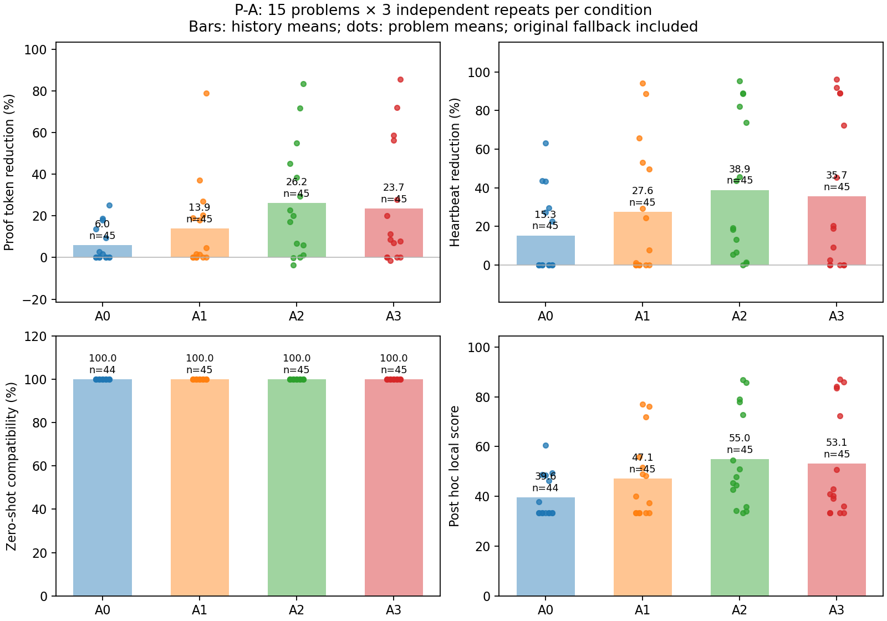
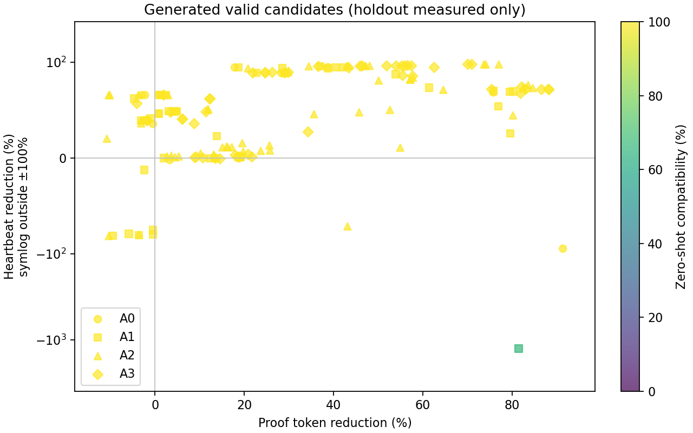
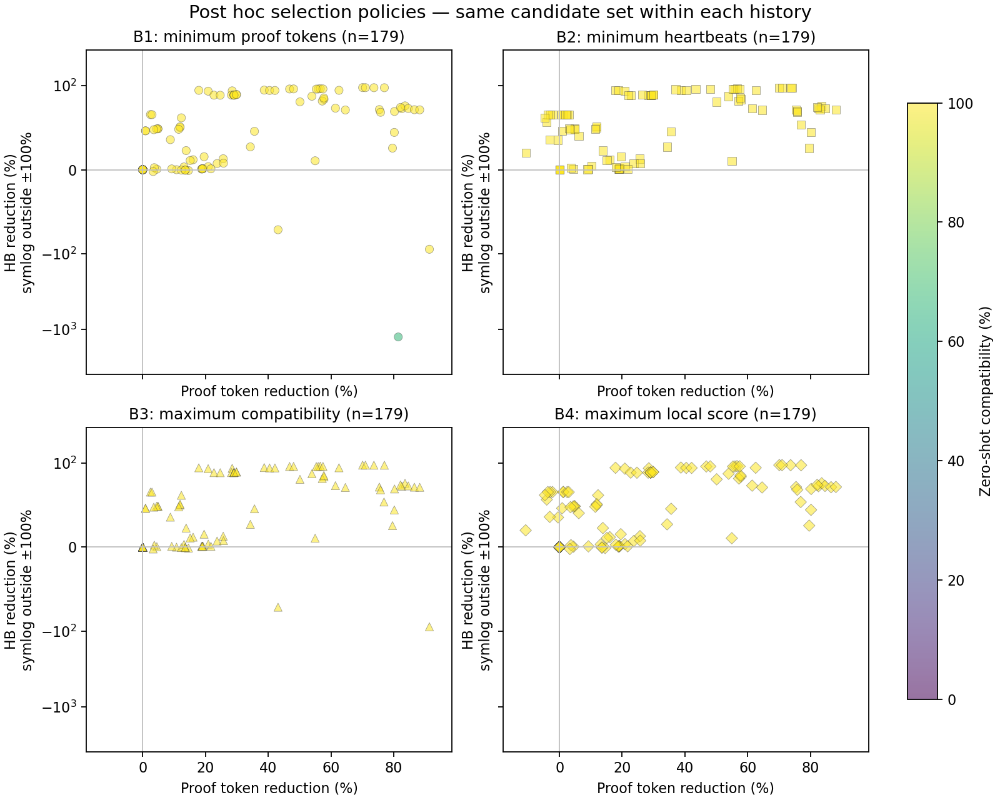
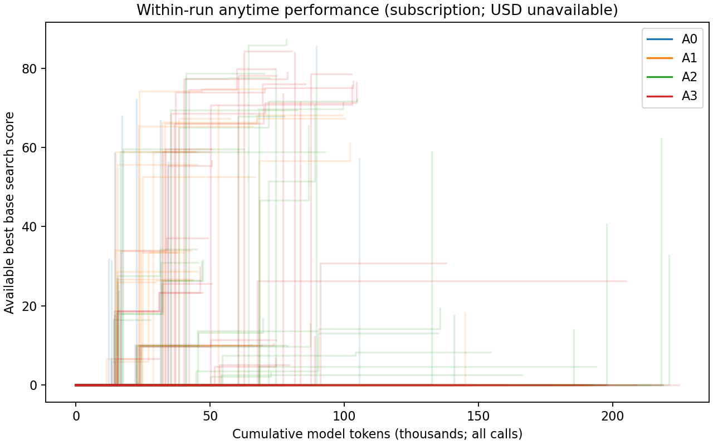
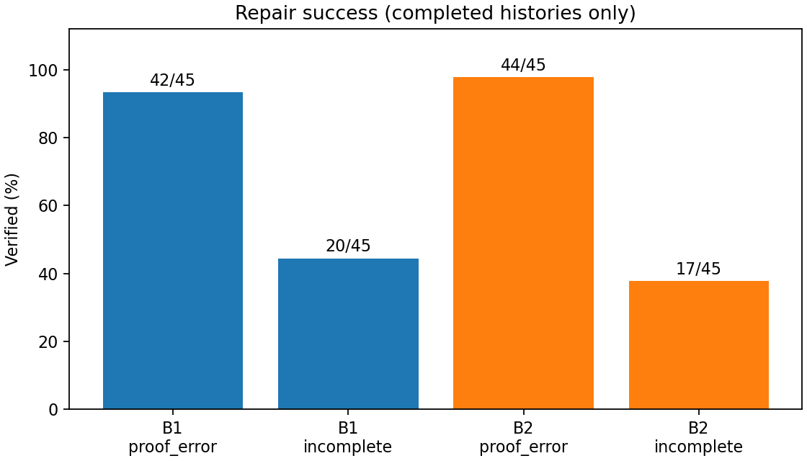

# 실험 진행·결과 보고서

> 공유 정리: 2026-10-24. 원래 완료 보고서의 수치·결론을 유지하고 링크를 evidence 위치에 맞췄다. 이번 정리에서 새 모델·Lean 실행은 하지 않았다. 2026-10-25 Week 4 공유 자료다. 전체 이력의 재생 자료는 보존하고 큰 중복 검증 출력은 PR에서 생략했다. 포함·생략 범위와 압축 자료 사용법은 [근거 안내](evidence/README.md)를 따른다.
>
> [자료 안내](README.md) · [측정 요약](experiment-metrics.json) · [검증·수리 구현](../../../verifier-guided-agent/손지연/report.md) · [새 위치의 재생 명령](evidence/README.md)

실행: `20261024T000653+0900`. 상태: 실행·후속 평가 완료.

정상 원본 기준 검증 15/15, 환경 15/15, P-A 180/180, V-A 90/90, V-B 180/180.

실제 모델 호출 795회, 확인된 입출력 token 27,992,967. API USD 비용·공식 점수·USD 3 준수 여부는 측정 불가(null).

최종 usage 미수신 호출 1회, 진행 중 usage 0회. 미수신 사용량을 0으로 가정하지 않으며 총 token은 이들이 해소되기 전까지 null이다. 확인된 합계는 하한이다.

240,000 soft token 상한 초과 이력 2건, 확인된 초과량 합계 12,062 token. 응답 전 예약 추정과 실제 usage의 차이이며 감지 후 추가 호출·후보 채택을 중단했다. 구독 transport의 hard output cap을 보장하지 못한다.

후보/환경 호환성 검사 504/504. 이 분모는 완료된 P-A 후보군을 반영하므로 주 실행 중에는 증가한다.

P는 정상 proof를 제공한 리팩터링이다. V는 통제된 proof 오류/미완성 변형을 사용하고 원본 정답 proof를 모델에게 숨겼다. 모든 모델은 기존 GPT 구독 인증으로 호출했다.

기준 버전만 사용하는 H 모드다. 선택을 고정한 뒤 지정된 모든 버전에서 동일 proof bytes를 평가한다. P-B의 호환성/종합 점수 선택은 사후 분석이며 실제 선택을 바꾸지 않는다.

지정 환경 수는 문제마다 다르다. P1·P2·P4·P5·P6은 1개 환경이므로 이 문제들의 1/1 호환성은 여러 버전의 통과를 뜻하지 않는다. 나머지 문제는 실제 지정된 2~4개 환경을 분모로 사용한다.

고정 조건은 [protocol.json](evidence/experiment/runs/20261024T000653+0900/protocol.json), 버전·commit·경로는 [환경 manifest](evidence/experiment/runs/20261024T000653+0900/environment_manifest.json)에 있다. 모델은 gpt-5.6-sol, effort high, 파일·웹·셸 도구 없는 새 이력이다. sampling/seed 및 강제 출력 token 상한은 구독 CLI에서 확보하지 못했다. A0는 1회, A1~A3은 최대 3회, V-B는 최대 4회 호출한다. Lean/모델 프로세스 timeout은 각각 300초, 이력 wall time은 5,400초다.

호스트 정보는 [runtime manifest](evidence/experiment/runs/20261024T000653+0900/runtime_manifest.json), 병렬 실행은 [parallelism manifest](evidence/experiment/runs/20261024T000653+0900/parallelism_manifest.json)와 [실행 중 조정 기록](evidence/experiment/runs/20261024T000653+0900/runtime_adjustments.jsonl)에 있다. 같은 호스트에서 여러 이력·검증이 겹쳤으므로 wall timeout/지연을 격리된 성능이나 공급자 오류율로 해석하지 않는다. native heartbeat는 wall time과 별도로 계측했다.

A0는 한 번 제안한다. A1은 원본에서 새 후보를 만들며 실패 진단을 피드백하지 않는다. A2는 현재 후보·원시 진단으로 수리하고 성공 이후에도 탐색한다. A3는 A2에 기준 버전 token/HB·탐색 점수 피드백을 추가한다. 모든 조건이 검증된 원본 fallback을 보존한다.

| P-A | 완료/예정 | 생성 선택 | 원본 유지 | 점수 개선 | token 감소 % | HB 감소 % | 호환성 % | 로컬 종합 | 호환성 측정 |
|---|---:|---:|---:|---:|---:|---:|---:|---:|---:|
| A0 | 45/45 | 14 | 31 | 14 | 6.00 | 15.32 | 100.00 | 39.57 | 44/45 |
| A1 | 45/45 | 21 | 24 | 21 | 13.88 | 27.56 | 100.00 | 47.15 | 45/45 |
| A2 | 45/45 | 34 | 11 | 34 | 26.25 | 38.89 | 100.00 | 55.05 | 45/45 |
| A3 | 45/45 | 27 | 18 | 27 | 23.65 | 35.66 | 100.00 | 53.10 | 45/45 |

| P-A | 실제 모델 호출 | 저장 제안 후보 | 확인된 input token | 확인된 output token |
|---|---:|---:|---:|---:|
| A0 | 45 | 45 | 1,173,459 | 212,161 |
| A1 | 135 | 135 | 3,520,377 | 653,251 |
| A2 | 131 | 131 | 4,295,205 | 528,275 |
| A3 | 130 | 130 | 4,190,722 | 578,879 |

탐색 점수 개선은 사전 정의한 기준 환경 search_score > 0이다. token과 HB가 모두 감소했다는 뜻은 아니며, 작은 차이는 별도 heartbeat 재계측 변동과 함께 읽어야 한다.

180/180 최종 verified에는 원본 fallback 84회가 포함된다. 생성 후보를 선택한 96회와 구분해야 한다. 후보 검증 성공을 곧바로 원본보다 개선한 새 증명 수라고 해석하지 않는다.

| V-A | 검사 | 오수락 | 오거절 | 보류 | 관측 불가 |
|---|---:|---:|---:|---:|---:|
| A1 | 90 | 38 | 0 | 0 | 0 |
| A2 | 90 | 38 | 0 | 0 | 0 |
| A3 | 90 | 0 | 0 | 0 | 0 |

V-A의 A1은 종료 코드, A2는 종료 코드와 실제 native InfoTree의 바깥 tactic goals_after, A3는 고정 명제·정책·완성 여부·전이 공리를 검사한다. 오수락 종류별 개수는 {"A1": {"direct_sorry": 15, "indirect_sorry": 15, "changed_statement": 8}, "A2": {"direct_sorry": 15, "indirect_sorry": 15, "changed_statement": 8}, "A3": {}}. 이 통제된 fixture 집합에서의 결과이며 일반적 오수락률을 추정한 수치가 아니다.

| V-B | 오류 유형 | 완료/예정 | verified | 성공률 | 모델 호출 |
|---|---|---:|---:|---:|---:|
| B1 | proof_error | 45/45 | 42 | 93.33% | 55 |
| B1 | incomplete | 45/45 | 20 | 44.44% | 125 |
| B2 | proof_error | 45/45 | 44 | 97.78% | 48 |
| B2 | incomplete | 45/45 | 17 | 37.78% | 126 |

| V-B | 오류 | 성공 이력의 평균 호출 | 무효 후보 발생 | 정상 원본과 같은 proof 복구 | 확인된 input / output token |
|---|---|---:|---:|---:|---:|
| B1 | proof_error | 1.12 | 4 | 9 | 1,667,175 / 141,233 |
| B1 | incomplete | 2.15 | 11 | 0 | 4,027,467 / 694,675 |
| B2 | proof_error | 1.00 | 0 | 10 | 1,426,363 / 116,124 |
| B2 | incomplete | 1.94 | 13 | 0 | 4,077,204 / 690,397 |

성공 이력 평균 호출의 분모는 위 표의 verified 수다. 정상 원본과의 비교는 proof bytes의 동일성만 뜻하며, 최적화 지표는 P 실험에 별도로 기록했다.

B1 incomplete에는 usage 미수신 호출 1건이 있어 확인된 token 합계는 하한이다.

V-B 전체 종료 분포: {"subscription_token_reservation_limit": 17, "verified": 123, "repair_limit": 25, "repeated_candidate": 9, "subscription_token_limit": 2, "subscription_timeout": 1, "timeout": 3}. 성공 이력만 남기지 않고 완료된 180개 이력의 비용·중단 사유를 집계했다.

V-B의 B1은 같은 진단·goal·local context 사실을 원시 텍스트로 제공하고, B2는 구조화된 상태·사실과 상태별 지침을 제공한다. 비교는 status 라벨 하나의 효과가 아니라 진단 표현·지침·이어진 이력 및 프롬프트 비용을 포함한다. B2−B1 복구 횟수 차이는 {"proof_error": 2, "incomplete": -3}. P의 정상 proof 리팩터링 성과와 V의 손상 proof 복구율은 같은 성공 지표로 합치지 않는다.

P-B는 같은 이력의 유효 후보와 원본 fallback에 네 선택 정책을 적용한 사후 비교다. B4가 같은 종합 점수에서 최대인 것은 선택 정의의 결과이며 생성 능력의 우월성 근거가 아니다.

| P-B 정책 | 선택 가능 이력 | C·점수 측정 이력 | token 감소 평균 % | HB 감소 평균 % | 호환성 평균 % | 로컬 종합 평균 |
|---|---:|---:|---:|---:|---:|---:|
| min_tokens | 180 | 179 | 18.61 | 18.33 | 99.81 | 45.40 |
| min_heartbeats | 180 | 179 | 16.97 | 29.43 | 100.00 | 48.63 |
| max_compatibility | 179 | 179 | 18.38 | 25.34 | 100.00 | 47.91 |
| max_local_score | 179 | 179 | 17.24 | 29.06 | 100.00 | 48.77 |

token 최소와 HB 최소는 분석 가능한 180개 이력 중 32개에서 서로 다른 후보를 골랐다. 정책별 동일 후보 선택 수와 단일 지표 선택에 따른 점수 차이는 [정책 충돌 분석](evidence/experiment/runs/20261024T000653+0900/analysis/policy_conflicts.json)에 있다.

P-C의 USD 0.50/1/2/3 체크포인트는 [USD 분석](evidence/experiment/runs/20261024T000653+0900/analysis/usd_budget_checkpoints.json)에 모두 null로 보존했다. 아래는 별도 보조축인 실제 누적 model token 기준이며 달러 예산 동등 비교를 뜻하지 않는다. 모델 응답이 도착한 시점과 Lean 검증이 끝나 후보가 이용 가능해진 시점을 구분했다. 조기 종료 이력은 마지막 best를 유지한다.

| 조건 | 40k token | 80k token | 160k token | 240k token |
|---|---:|---:|---:|---:|
| A0 | 10.66 | 10.66 | 10.66 | 10.66 |
| A1 | 17.30 | 20.21 | 20.72 | 20.72 |
| A2 | 9.27 | 22.99 | 29.24 | 32.57 |
| A3 | 11.52 | 23.24 | 29.66 | 29.66 |

[문제별 평균·중앙값·범위](evidence/experiment/runs/20261024T000653+0900/analysis/problem_summary.json), [문제 내 평균의 대응 차이](evidence/experiment/runs/20261024T000653+0900/analysis/paired_problem_comparison.json), [독립 반복의 코드 해시 분산](evidence/experiment/runs/20261024T000653+0900/analysis/repeat_variation.json)을 별도로 보존했다. 전역 평균은 모든 3회 반복이 있는 조건의 기술통계이며, 호환성 미측정 값은 평균 분모에서 제외하고 측정 이력 수를 함께 표시한다.

A0는 한 번만 호출하므로 다른 조건보다 실제 소비량이 작다. 구독 실행은 USD 3 동등 비용·공식 대회 규칙 준수 실험으로 해석할 수 없다.

이 실행의 원본 fallback 포함 기준 버전 token/HB 평균 감소 합은 A2에서 가장 컸다. 점수 피드백의 추가가 항상 더 좋은 후보를 만든다고 결론 내리지 않는다.

새 모델 독립 반복과 기록 재생·새 Lean 실행은 서로 다른 결과다. 새 생성의 코드 일치 관측은 다음과 같다.

| 새 생성 반복 | 문제·조건 그룹 | 3회 최종 proof가 모두 같은 성공 그룹 | 첫 후보 3개가 모두 다른 그룹 |
|---|---:|---:|---:|
| P_A | 60 | 19 | 57 |
| V_B | 60 | 7 | 41 |

P의 같은 최종 proof에는 원본 fallback도 포함된다. 같은 선택 결과나 높은 재생 일치율은 모델 생성의 결정성을 보장하지 않는다.

V-C 기록 재생: 360/360 이력 일치. 추가 모델 0회, Lean 0회.

V-C 실제 Lean 재검증: 1212/1213 판정·해시·환경 및 관측된 공리 비교 일치. 항목별 일치 수: {"status": 1212, "proof_sha256": 1213, "axioms": 1176, "diagnostics_exact": 3, "diagnostic_messages": 1211, "proof_tokens": 1179, "raw_heartbeats": 59, "environment_id": 1213}.

재검증 단위는 문제·proof SHA·환경·check_kind다. 같은 proof의 candidate/final 판정은 별도 비교하며, check_kind를 합친 문제·proof·환경 조합은 1037개다. 이를 새 모델 독립 실행 수에 더하지 않는다.

위 항목별 비교 가능 분모: {"status": 1213, "proof_sha256": 1213, "axioms": 1176, "diagnostics_exact": 1213, "diagnostic_messages": 1213, "proof_tokens": 1179, "raw_heartbeats": 754, "environment_id": 1213}. 한쪽이라도 미측정인 token/HB/공리는 값 비교에서 제외한다.

미측정 ↔ 관측으로 바뀐 항목 수: {"axioms": 1, "proof_tokens": 1, "raw_heartbeats": 1}. 관측 유무의 변화와 실제 측정값 차이는 분리했다.

HB 재계측 상대 변화(%): {"n": 754, "median": -5.1070845854771774e-05, "median_absolute": 0.0016461587367089148, "min": -0.25768680739496785, "max": 0.21993821668001032}. 진단 원문에는 임시 파일 경로 차이가 있어 원문 완전 일치와 메시지 내용 일치를 따로 비교한다.

판정·공리·메시지·token 등 항목별 불일치 근거는 [재검증 차이 목록](evidence/experiment/runs/20261024T000653+0900/analysis/revalidation_differences.json)에 있다. 원래 판정·계측을 새 값으로 덮어쓰지 않았다.

status 불일치 1건. 첫 사례: P13 / mathlib-v4.27.0, timeout → verified ([원문 비교](evidence/experiment/runs/20261024T000653+0900/revalidation/P13/ca3ab5d806a301aa693020d397e0550c9c5d4ad9465f911ffc3a1c4c99b7d027-holdout/mathlib-v4.27.0/comparison.json)).

diagnostic_messages 불일치 2건. 첫 사례: P12 / arklib-v4.31.0, resource_limit → resource_limit ([원문 비교](evidence/experiment/runs/20261024T000653+0900/revalidation/P12/592066d7f90eb93edb73926ed54a336fbb55c2e4280b5185443646f34d8f530c-candidate/arklib-v4.31.0/comparison.json)).

timeout → verified 관측 1건은 자원·시간 판정의 불일치다. 같은 proof와 환경 해시는 보존됐으며, 최초 호환성·주 점수의 미확정 기록은 유지한다. 뒤의 성공을 최초 실행 결과로 소급하지 않았다.

V-C 대조: 9/9 경로 통과. 15문제 전체 V-A fixture 참조 완료 여부: True. 실제 timeout·환경 검사와 synthetic 모델/정책 검사를 구분했다.

완료된 실제 Lean subprocess 기록은 8,476건이다. 한 후보 검증은 guard·컴파일·계측·InfoTree/공리 검사 등 여러 subprocess를 사용할 수 있어 후보 수와 다르다. 의존성 build/cache와 진행 중 프로세스는 이 수에 넣지 않는다. 영역별 수: {"baseline": 60, "V_A": 400, "runs": 3149, "holdout_baseline": 142, "holdout_checks": 1040, "revalidation": 3661, "controls": 13, "module_audit_probe": 2, "module_audit_probe_retry2": 2, "module_audit_probe_retry3": 7}.

감사: ledger 사용량 산술 불일치 0건, 모델 도구 사용 0건, 요청의 로컬 절대 경로 노출 0건, 중복 thread 0건. 원본 재사용 패키지 불변: True. 미수신 usage와 soft 상한 초과는 이 무결성 검사 통과와 별개다.

실제 첫 입력 360건의 원본/손상 source 구성 불일치 0건. V-B의 같은 문제·오류·반복에 해당하는 B1/B2 90쌍에서 초기 손상 proof·문맥·진단 사실·상한 불일치 0건.

대표 실행은 성공·원본 유지·실패·자원 중단을 함께 추적할 수 있도록 골랐다. 각 링크의 events.jsonl, model_calls/, candidates/, result.json이 원문 근거다.

| 사례 | 문제·조건·반복 | 종료 | 선택 | 기록 |
|---|---|---|---|---|
| P: generated improvement | P1 / A2 / 1 | search_call_limit | generated | [result](evidence/experiment/runs/20261024T000653+0900/runs/P_A/P1/normal/A2/repeat_1/result.json) · [events](evidence/experiment/runs/20261024T000653+0900/runs/P_A/P1/normal/A2/repeat_1/events.jsonl) |
| P: original fallback | P1 / A0 / 1 | one_shot_complete | original | [result](evidence/experiment/runs/20261024T000653+0900/runs/P_A/P1/normal/A0/repeat_1/result.json) · [events](evidence/experiment/runs/20261024T000653+0900/runs/P_A/P1/normal/A0/repeat_1/events.jsonl) |
| V: verified repair | P1 / B1 / 2 | verified | generated | [result](evidence/experiment/runs/20261024T000653+0900/runs/V_B/P1/incomplete/B1/repeat_2/result.json) · [events](evidence/experiment/runs/20261024T000653+0900/runs/V_B/P1/incomplete/B1/repeat_2/events.jsonl) |
| V: repair limit | P10 / B1 / 3 | repair_limit | None | [result](evidence/experiment/runs/20261024T000653+0900/runs/V_B/P10/incomplete/B1/repeat_3/result.json) · [events](evidence/experiment/runs/20261024T000653+0900/runs/V_B/P10/incomplete/B1/repeat_3/events.jsonl) |
| V: Lean timeout | P15 / B1 / 3 | timeout | None | [result](evidence/experiment/runs/20261024T000653+0900/runs/V_B/P15/incomplete/B1/repeat_3/result.json) · [events](evidence/experiment/runs/20261024T000653+0900/runs/V_B/P15/incomplete/B1/repeat_3/events.jsonl) |
| V: model timeout and unknown usage | P12 / B1 / 3 | subscription_timeout | None | [result](evidence/experiment/runs/20261024T000653+0900/runs/V_B/P12/incomplete/B1/repeat_3/result.json) · [events](evidence/experiment/runs/20261024T000653+0900/runs/V_B/P12/incomplete/B1/repeat_3/events.jsonl) |
| V: detected soft token overrun | P11 / B1 / 3 | subscription_token_limit | None | [result](evidence/experiment/runs/20261024T000653+0900/runs/V_B/P11/incomplete/B1/repeat_3/result.json) · [events](evidence/experiment/runs/20261024T000653+0900/runs/V_B/P11/incomplete/B1/repeat_3/events.jsonl) |

[후보 계보와 proof diff](evidence/experiment/runs/20261024T000653+0900/analysis/candidate_lineage.json)는 실제 전송 요청의 입력 proof와 대조해 사후 생성했다. A0/A1은 매번 정상 원본을 부모로, A2/A3/V-B는 실제 직전 입력 후보를 부모로 기록한다. 원래 요청·응답·판정 기록은 변경하지 않았다.

직접 sorry는 패키지의 엄격 guard가 `invalid_candidate(policy)`로 거절할 수 있다. DESIGN의 기대 상태 `incomplete`와의 라벨 차이는 별도 파일에 기록하며, 이를 오수락과 혼동하지 않는다.

15문제의 작은 개발 표본에 대한 기술통계다. 문제별 결과와 독립 반복을 보존하며, 정책·반복 간 후보를 하나의 예산 실행처럼 합치지 않는다.

보존 기록: 대표 사례는 직접 연결하고, 나머지 이력·입력·fixture·호환성 기록은 `records.tar.gz`에 보관한다. [요약](evidence/experiment/runs/20261024T000653+0900/analysis/summary.json), [선택 비교](evidence/experiment/runs/20261024T000653+0900/analysis/selection_comparison.json), [이용 가능 시점별 곡선](evidence/experiment/runs/20261024T000653+0900/analysis/budget_curve.json), [재생](evidence/experiment/runs/20261024T000653+0900/analysis/record_replay.json), [새 Lean 재검증](evidence/experiment/runs/20261024T000653+0900/analysis/lean_revalidation.json.gz), [감사](evidence/experiment/runs/20261024T000653+0900/analysis/audit.json). 당시 재실행·재개 명령과 구현 보정 내역은 보존된 [README](evidence/experiment/README.md)에 있다. 현재 위치에서는 [근거 안내](evidence/README.md)의 `packaging/reproduce.py`로 기록을 재생한다. 생략된 원시 출력에 의존하는 전체 분석·Lean 재실행은 이번 PR의 검증 범위 밖이다.

공식 규칙: https://huggingface.co/spaces/delta-lab-ai/lean-refactor-arena — 공개 Space는 UI이고 채점 worker는 별도다. 로컬 계측은 공식 worker 동등성이 확인된 결과가 아니다.

Proof token은 각 고정 환경의 Lean lexer로 직접 센 로컬 값이다. 데이터셋의 proof_length와 다른 문제가 있어 baseline_comparison.json에 대조했다. 감소율의 분모는 동일 로컬 방식으로 측정한 원본이며 공식 채점과 같다고 주장하지 않는다.

구독/API 비용 구분: https://learn.chatgpt.com/docs/pricing — 구독 token을 API 목록 가격으로 환산하여 실제 지출이라고 보고하지 않았다.

[SVG 내려받기](evidence/experiment/runs/20261024T000653+0900/figures/performance_summary.svg)

[SVG 내려받기](evidence/experiment/runs/20261024T000653+0900/figures/tradeoff.svg)

[SVG 내려받기](evidence/experiment/runs/20261024T000653+0900/figures/selection_tradeoff.svg)

[SVG 내려받기](evidence/experiment/runs/20261024T000653+0900/figures/token_budget_curve.svg)

[SVG 내려받기](evidence/experiment/runs/20261024T000653+0900/figures/feedback_success.svg)
