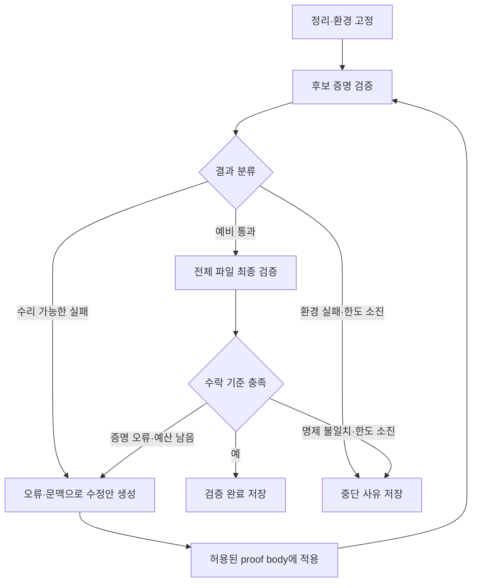

# LeanAgent W3 — 검증·수리 설계안

작성·자료 확인일: 2026-10-17 (Asia/Seoul)

## 1. 담당 범위와 이번 주 결론

검증·수리 모듈은 **고정된 Lean 정리와 실패한 증명 후보를 받아, 실제 Lean 피드백을 수집하고, 제한된 횟수 안에서 수정 후보를 재검증하며, 최종 결과를 판정하는 부분**이다.

이번 주에는 세 가지를 제안한다.

1. 기존 시스템을 검증 인터페이스, 수리 정책, 실행 하네스로 나누어 비교한다.
2. 작은 공개 런타임에서 정상→실패→수정→전체 재검증의 실제 로그를 보여준다.
3. `verify(candidate) -> VerificationResult`와 `repair(request) -> RepairProposal`의 계약, 성공 기준, 종료 정책을 합의한다.

이 패키지의 `experiment/`는 실제 실행한 공개 REPL 실험이다. 수정 후보는 미리 정해 둔 것이며 LLM을 호출하지 않았다. 아래의 모델 연결·자동 수리 controller는 설계 제안이다. APOLLO·LeanAgent 전체나 mini-Lean-agent의 모델 실험을 재현한 결과로 해석해서는 안 된다.

## 2. 공개 시스템 비교

| 계층 / 대상 | 입력과 피드백 | 제어·수정 단위 | 이번 설계에 반영 |
| --- | --- | --- | --- |
| LeanAgent 논문 시스템 / LeanDojo 계열 | proof state에서 tactic을 실행하고 다음 state를 받음 | 검색 controller가 tactic 후보를 확장하고 되돌아감 | 실패한 시도와 마지막 유효 state를 구분한다. 논문 LeanAgent와 팀의 Pseudo-Lab/LeanAgent는 동명 프로젝트다. [1][2] |
| community REPL / LeanInteract | 전체 command/file, errors·warnings·위치·sorries·env; tactic mode의 proofState와 goals | REPL은 실행 통로이고, 다음 후보 선택은 호출자가 담당 | Python 검증 adapter의 기반으로 사용한다. 이번 실험은 community REPL만 직접 실행했다. [3][4] |
| Pantograph / PyPantograph | state·goal을 지정한 tactic 실행, 다음 goals; metavariable coupling 처리 | tactic 단위 탐색을 위한 interface | 팀이 나중에 분기 탐색을 도입할 때 비교한다. 현재 README에는 전체 파일 specification conformity 검사도 안내되어 있다. [5] |
| APOLLO | Lean REPL diagnostics로 오류 위치와 실패 block 식별 | 구문 수정→실패 부분 분리→자동 tactic→남은 sublemma의 LLM 수리→조립 | 현재 proof와 오류 위치·local context를 보존하고 작은 변경부터 시도한다. 재귀 sublemma 분리는 후속 단계로 둔다. [6][7] |
| APRIL | 잘못된 proof, compiler feedback, 진단 설명, 수정 proof | 오류를 포함한 데이터셋과 단발 수리 학습·평가 | P7/P12의 정상 proof에 의도적 오류를 넣고 실제 진단을 보존하는 사례 형식을 참고한다. 반복 harness 자체는 아니다. [8] |
| mini-Lean-agent | 모델은 bash로 파일·검색·Lean에 접근; 제출 후 별도 evaluator | mini-SWE-agent 루프를 재사용하고 최종 Comparator 검증 추가 | 생성·수리 실행과 최종 수락을 구분한다. README상 최종 제출 뒤에는 추가 proof attempt가 없다. [9][10] |
| Claude Agent SDK | model tool call→실행→tool result→다음 모델 호출 | 세션, 도구 실행, turn·비용 한도, 종료 결과 | SDK 정상 종료와 proof 검증 성공을 다른 필드에 기록한다. [11] |

읽기 우선순위는 **APOLLO §3 → REPL protocol → mini-Lean-agent README → APRIL의 데이터 구성**이다. LeanAgent의 전체 lifelong learning 구조는 참고하고, 검증·수리 담당 발표에서는 tactic 실행과 실패 처리가 있는 부분에 집중한다.

### 확인 범위와 버전

- APOLLO 논문은 arXiv v5(2025-11-04)를 확인했다. 공개 `apollo.py`에서는 `ApolloRepair`, `fix_code`, `run`, 재귀 깊이 제한을 읽었다. `run()`의 최종 파일 저장만 보고 전체 프로젝트가 최종 검증을 하지 않는다고 단정할 수는 없다. 이번 제안은 마지막 검증 호출을 controller 계약으로 명시한다. [6][7]
- APRIL 논문은 2026-02-03 제출, 2026-03-13 개정이다. 데이터셋·단발 수리 설정을 참고한다. [8]
- mini-Lean-agent 논문은 2026-10-12 제출이다. 현재 README 예제는 Lean/Comparator v4.33.0, 논문 실험은 v4.28.0-rc1이므로 버전을 혼합해 재현했다고 말하면 안 된다. README·논문·개발 안내를 조사했으며 내부 runner 전체를 직접 실행하지 않았다. [9][10]
- 실제 실행은 Lean 4.19.0 + REPL tag v4.19.0, commit `3b27c8543a48444ffab4077f47526d91849cca3d`이다. 최신 버전 성능이나 전체 시스템 재현을 위한 선택이 아니라, 동일 버전으로 두 실행 모드를 비교하는 작은 실험이다.

## 3. 실제 실행 결과

대상 정리:

```lean
theorem and_swap (P Q : Prop) (h : P ∧ Q) : Q ∧ P := by
  constructor
  · exact h.2
  · exact h.1
```

의도적 오류는 첫 번째 `exact h.2`를 `exact h.1`로 바꾸는 한 줄 변경이다. 이때 목표는 `Q`인데 제공한 증거는 `P`이다.

### CLI 결과

| 파일 | 실제 종료 코드 | 실제 결과 |
| --- | --- | --- |
| `baseline.lean` | 0 | 정상 통과 |
| `broken.lean` | 1 | `type mismatch`, `P`와 `Q` 불일치 |
| `repaired.lean` | 0 | 정상 통과 |
| `sorry.lean` | 0 | `declaration uses 'sorry'` 경고, 미완성 |

원시 로그의 실패 메시지:

```text
type mismatch
  h.left
has type
  P : Prop
but is expected to have type
  Q : Prop
```

### REPL에서 확인한 상태 차이

| 관찰 | 실제 반환 | 의미 |
| --- | --- | --- |
| 전체 잘못된 command | `messages[].severity="error"`, `env`도 반환 | env 존재가 성공을 뜻하지 않는다. |
| 잘못된 tactic | `message="Lean error:..."`, goals 키 없음 | goals 미수집과 빈 목록을 구분해야 한다. |
| 잘못된 tactic 이후 수정 | 같은 `proofState=1`에서 `exact h.2` 성공 | 실패 전 state에서 재시도할 수 있다. |
| 정상 tactic 경로 완료 | `proofStatus="Completed"`, `goals=[]` | 해당 proof state의 완료다. |
| tactic으로 `sorry` 실행 | `proofStatus="Incomplete: contains sorry"`, `goals=[]`, sorries 존재 | goals만 보고 완료로 판단하면 잘못된다. |
| 정상 tactic 경로 완료 후 원본 env 조회 | `and_swap` 공리 의존성 `[sorryAx]` | 원본 선언에 완성된 tactic 경로가 자동 반영되지 않았다. |
| 수정 proof를 전체 command로 재조립·재검증 | `and_swap`는 공리에 의존하지 않음 | 최종 파일에 수정이 실제 반영됐는지 별도 확인해야 한다. |
| 오류를 포함한 REPL 세션 종료 | process return code 0 | 서버 정상 종료와 개별 요청의 성공을 구분해야 한다. |

`experiment/logs/trace.jsonl`에는 요청·응답 12개가, `summary.json`에는 버전·commit과 CLI 결과가 담겨 있다. `protocol.in`, `protocol.out`, 각 compiler log도 보존했다. 이 소규모 실험의 시간은 성능 비교 수치로 사용하지 않는다.

## 4. 최소 실행 구조



구현은 처음에 하나의 Python controller로 시작해도 된다. 다음은 논리적 책임 구분이며, 각각을 별도 에이전트나 서비스로 만들 필요는 없다.

| 책임 | 입력 | 출력 |
| --- | --- | --- |
| TaskSpec | source repo, commit, toolchain, 원본 정리, 수정 허용 범위 | 고정된 문제 |
| LeanRunner / verifier adapter | 파일 또는 proof body | 실제 diagnostics, goals, sorries, 실행 상태 |
| RepairPolicy / model adapter | 현재 proof, 실제 오류, local context, 이전 시도 요약 | 수정된 proof body와 짧은 진단 |
| Controller | 후보와 검증 결과 | 적용·재시도·중단 결정 |
| FinalVerifier | 실제 반영된 파일, 원본 문제 | 최종 수락·거절 |
| Trace | 모든 후보·도구 결과·종료 사유 | 재현 가능한 JSONL과 원시 로그 |

### 첫 버전에서 고정할 결정

1. 하나의 task는 하나의 기존 Lean 정리를 대상으로 한다.
2. imports, theorem statement, 가정, 의존성, toolchain은 고정한다.
3. 모델은 proof body만 제안한다. body 안의 `have` 등 국소 보조증명은 허용할 수 있다.
4. 입력 proof를 먼저 검증하고, 수정 호출은 최대 3회로 시작한다. 3회는 이번 주 실험용 제안값이다.
5. compiler wall-clock timeout, 모델/API timeout, 전체 task budget을 구분한다. 프로젝트 baseline 시간을 측정해 값들을 정한다.
6. 이미 판정이 완료된 동일 후보는 중복 실행을 생략한다. `timeout`과 `environment_error`는 확정된 proof 판정으로 캐시하지 않고 별도 재시도 정책을 적용한다.
7. 최초에는 전체 proof body를 교체한다. block 단위 patch, 자동 sublemma 추출, 여러 agent의 병렬 수리는 이후에 추가한다.
8. 각 시도는 원본 파일을 덮어쓰지 않고 별도 후보 파일로 기록한다.
9. 사용 중인 Lean backend를 교체해도 model adapter가 같은 `VerificationResult`를 받게 한다.

## 5. 결과 계약

`VerificationResult`의 제안 예시는 다음과 같다. 이 JSON은 공개 라이브러리의 실제 API를 그대로 옮긴 것이 아니다.

```json
{
  "task_id": "warmup_07",
  "attempt": 1,
  "candidate_hash": "...",
  "environment_id": "repo_commit+toolchain+dependency_lock",
  "check_kind": "candidate",
  "status": "proof_error",
  "process_exit_code": 0,
  "diagnostics": [
    {
      "severity": "error",
      "source": "repl_command",
      "position": {"line": 3, "column": 4},
      "message": "actual Lean diagnostic"
    }
  ],
  "goals": null,
  "sorries": null,
  "backend_proof_status": null,
  "statement_check": "not_run",
  "axioms": null,
  "elapsed_ms": 0,
  "raw_log_path": "attempt_01.raw.json"
}
```

- `goals=null`: 수집하지 못함. `goals=[]`: backend가 실제로 빈 목록을 반환함. 서로 다르다.
- CLI, REPL command, REPL tactic은 실패의 출력 형태가 다르다. adapter에서 명시적으로 변환하고 원시 값도 보존한다.
- `process_exit_code=0`인 REPL 요청에도 proof error가 있을 수 있다.
- `statement_check`와 `axioms`가 아직 검사되지 않았으면 성공값을 채우지 않는다.

| status | 의미 | 후속 조치 |
| --- | --- | --- |
| `candidate_pass` | 예비 검증 통과 | 최종 검증으로 이동 |
| `proof_error` | 타입·구문·tactic 오류 | 오류와 현재 proof를 모델에 전달 |
| `incomplete` | 남은 목표 또는 `sorry` 의존 | 수리 계속 |
| `invalid_candidate` | 허용 범위 이탈 또는 고정 문제 변경 | 후보 거절 |
| `timeout` | 제한 시간 내 판정을 얻지 못함 | 자원 실패로 기록; 정리가 거짓이라는 뜻이 아님 |
| `environment_error` | toolchain·설치·고정 의존성 문제 | 환경 점검으로 이동 |
| `verified` | 최종 수락 기준 충족 | 성공 종료 |

전체 runner의 `stop_reason`은 이 상태와 별도로 `verified`, `repair_limit`, `wall_time_limit`, `repeated_candidate`, `environment_error`, `model_error` 등을 기록한다.

### 환경 오류의 분류

`unknown constant`나 import 관련 문자열만 보고 무조건 환경 오류로 분류하지 않는다. 고정된 기준 파일도 실패하면 환경 설정을 먼저 점검한다. 기준 파일은 통과하지만 모델이 없는 이름을 사용해 실패했다면 일반적으로 proof 후보의 오류다. 출력 문구를 분류 라벨로 축약해도 원문을 버리지 않는다.

## 6. 최종 수락 기준

검증 대상은 원래 정리다. 수락에는 다음 조건이 필요하다.

1. 원래 정리와 가정, 해당 의미를 결정하는 imports·정의·인스턴스가 유지된다.
2. 수정 내용을 반영한 전체 대상 파일을 고정된 환경의 새 프로세스에서 다시 검사한다.
3. Lean errors가 없으며 완성된 증명이어야 한다.
4. 대상 정리의 전이적 공리 의존성에 `sorryAx`가 없어야 한다.
5. 허용 공리 정책을 만족해야 한다. 일반적인 출발점은 `propext`, `Classical.choice`, `Quot.sound`이며, 기존 프로젝트에서 쓰는 추가 공리가 있다면 미리 명시적으로 결정한다.

`#print axioms theorem_name`은 간접 의존성도 보여준다. 소스에서 `sorry` 문자열을 검색하는 것으로 이 검사를 대신할 수는 없다. 주석에 있는 문자열은 미완성 증명이 아니며, 다른 lemma 안의 `sorry`는 현재 proof 본문에 문자열이 없어도 영향을 준다. [12]

정상적인 linter warning은 별도 품질 항목으로 기록한다. 예컨대 불필요한 변수 경고를 수학적 미증명과 같은 상태로 취급하지 않는다. P12의 `omit … in` 같은 정리는 증명 성공과 구분해 평가한다.

처음에는 고정 template·수정 범위 검사·새 프로세스 전체 검사·공리 검사를 구현한다. 모델 출력이 정확히 하나의 허용된 proof term/tactic body로 파싱되고 추가 top-level 명령을 만들지 않는지도 검사한다. 이 제한만으로 임의의 Lean 코드에 대한 의미 보존이 완전히 보증되지는 않는다. 임의 Lean 프로그램을 받는 공개 평가 수준으로 확장하면 원본 challenge와 제출 proof를 비교하는 Comparator/독립 checker를 검토한다. header의 문자열 hash는 의미적 동일성을 보증하는 검증기를 대체하지 않는다. [10][13]

## 7. P7/P12와 연결

앞서 만든 `lean_repair_case_kit.zip`의 README와 코드를 확인했다. 그 키트는 실제 원본 소스와 라이브러리 checkout을 입력으로 받아 정상·오류·수정 파일을 생성하고 실행하는 도구다. 키트 자체에는 신규 원시 실행 로그가 들어 있지 않다.

| 사례 | 기존 키트의 의도적 변경 | 설계 질문 |
| --- | --- | --- |
| P7 / `Typing.progress` | `ihLeft rfl leftTyped`를 `ihLeft rfl wholeTyped`로 바꿈 | 필요한 부분항의 typing 증거와 전달한 전체항의 증거를 실제 타입으로 비교할 수 있는가? |
| P12 / `tensor_success_split` | 점별 `fold` 등식과 `simp_rw [fold]`를 빼고 직접 적용을 시도 | 추가 tactic 탐색만으로 충분한가, 표현 대응을 위한 국소 등식이 필요한가? |
| 추가 경고 정책 사례 (설계 제안) | 불필요한 변수와 `omit … in`; 기존 키트의 생성 패치에 포함되지 않음 | proof validity와 lint policy를 구분하는가? |

P7/P12 두 proof 오류는 이전 키트의 사례 설계이고, 경고 정책 행은 추가 제안이다. 이번에 P7/P12 원본을 새로 실행한 결과가 아니다. 현재 이 작업 환경에는 해당 source와 Cslib/ArkLib checkout이 없었다. 따라서 이번 raw 로그는 Lean core의 `and_swap` 예제에서 얻은 것이다.

기존 프로젝트에서 재실행할 때의 경로:

```bash
python3 week2/P7/run_progress.py --variant refactored
python3 week2/P12/run_tensor_gaps.py --variant refactored
python3 lean_repair_case_kit/run_repair_cases.py --repo-root . --execute
```

이 명령은 기존 키트가 요구하는 project root에서 실행하는 사용법이다. 파일·checkout 경로가 다르면 키트의 경로 옵션을 사용한다. 정상 원본이 먼저 통과해야 의도적 오류의 효과를 해석할 수 있다.

**수동 복원과 모델 수리는 따로 기록한다.** 정상 파일을 `02_repaired`로 복사해 통과한 것은 배선과 verifier의 동작을 보여준다. 모델 수리 실험에서는 정상 정답 파일·정답 diff를 모델에게 제공하지 않고, 실패 후보와 허용 문맥·실제 Lean feedback만 준다.

## 8. 모델 연결 후 최소 비교 실험

같은 모델, 같은 오류 파일, 같은 imports·정리문, 같은 호출 횟수·출력 예산으로 두 조건을 비교한다.

| 조건 | 모델 입력 |
| --- | --- |
| A | 정리문 + 현재 실패 proof |
| B | A + 실제 Lean diagnostics + 얻을 수 있는 local goals/context |

각 조건의 최종 성공, 수정 시도 수, Lean 호출 수, 경과 시간, 실제 입력·출력 토큰 사용량을 기록한다. 모델이 실패 원인을 설명한 문장은 보조 관찰이며, 성공 판정은 최종 verifier가 담당한다. 두 사례의 결과만으로 일반적인 성능 우위를 주장하지 않는다.

## 9. 이번 주 제출물과 작업 순서

| 순서 | 할 일 | 완료 기준 |
| --- | --- | --- |
| 1 | 조사 비교표 | input, feedback, repair unit, controller, stop rule, 실행 여부를 같은 열에 정리 |
| 2 | 작은 runtime 데모 | 정상·실패·수정·sorry의 실제 code/log 제시 (이 패키지에 포함) |
| 3 | P7/P12 환경 재현 | 기존 원본 정상 통과 확인 후 의도적 오류·수정 로그 획득 |
| 4 | 최소 인터페이스 합의 | TaskSpec, VerificationResult, RepairProposal, 수락·중단 정책 정의 |
| 5 | 모델 1회 연결 | 실제 오류를 입력받아 후보를 만들고 전체 파일을 재검증하는 trace 확보 |

발표는 ① 담당 모듈의 입출력, ② 시스템 비교, ③ 실제 실패·복구 로그, ④ 성공 판정에서 발견한 함정, ⑤ 제안 구조와 남은 결정 순으로 구성한다.

팀에 전달할 한 문장:

> 검증·수리 파트에서는 고정된 정리와 실패 proof를 입력받아, Lean diagnostics를 공통 형식으로 돌려주고, 제한된 수정 루프를 실행하며, 전체 파일과 공리 의존성을 확인해 최종 성공을 판정하는 최소 모듈을 제안합니다.

## 출처

일차 출처만 사용했으며 2026-10-17에 확인했다. 논문 결과 수치나 모델 성능 재현은 이 패키지의 목표가 아니다.

1. LeanAgent, §3.4: https://arxiv.org/html/2410.06209v8
2. LeanDojo docs: https://leandojo.readthedocs.io/
3. community REPL README: https://github.com/leanprover-community/repl
4. LeanInteract README: https://github.com/augustepoiroux/LeanInteract
5. PyPantograph: https://github.com/stanford-centaur/PyPantograph
6. APOLLO, §3: https://arxiv.org/html/2505.05758v5
7. APOLLO controller: https://github.com/aziksh-ospanov/APOLLO/blob/main/apollo.py
8. APRIL / Learning to Repair Lean Proofs from Compiler Feedback: https://arxiv.org/abs/2602.02990
9. mini-Lean-agent paper: https://arxiv.org/abs/2610.17331 and https://arxiv.org/html/2610.17331v1
10. mini-Lean-agent code and README: https://github.com/TomasOrtega/mini-lean-agent
11. Claude Agent SDK loop: https://code.claude.com/docs/en/agent-sdk/agent-loop
12. Lean language reference, Axioms: https://lean-lang.org/doc/reference/latest/Axioms/
13. Lean language reference, Validating a Lean Proof: https://lean-lang.org/doc/reference/latest/ValidatingProofs/

